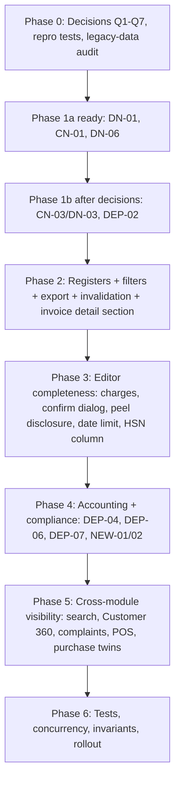

# Credit & Debit Notes Module: Audit & Implementation Plan (Revision 2)

**Document:** `CREDIT_NOTES_IMPLEMENTATION_PLAN.md`
**Revision:** 2 — 2026-10-13. Supersedes revision 1 after a code-verified review (see Appendix A for what changed and why).
**Status:** 🟢 **IMPLEMENTED 2026-10-13 (uncommitted).** All items are built and tested; see the completion record below. Decisions Q1–Q7 are answered.

## Completion record (2026-10-13)

### Decisions taken

| Q | Answer | How it was built |
|---|---|---|
| Q1 | Value-only credit notes consume 0 returnable quantity | Judged per **line**, because quantity × price makes quantity 0 impossible: a line credited below the sold net unit price (rate correction), or any `POST_SALE_DISCOUNT` note, keeps the goods returnable; a line credited at full price still uses up the units (SRF-06 unchanged). One rule, `credit_line_uses_goods`, is used by the returns screen, the return completion and the credit-note quantity cap. |
| Q2 | Contra account `4110`, new postings only, behind a flag | `4110 Sales Returns & Allowances` is in the chart (existing companies get it lazily the first time a posting asks for it). Credit notes debit it only when the company flag `ENABLE_CONTRA_SALES_ACCOUNT` is true; debit notes stay on `4100`. Schedule III revenue now nets `4100` and `4110`. History is not re-mapped. |
| Q3 | Owner, Manager and Accountant may submit a note IRN | `submit-einvoice` on notes; non-owner submissions are audited. Cancelling an IRN stays Owner-only. |
| Q4 | Complete the reward note inside mark-paid | One transaction: if the credit note cannot complete (period lock, deadline, HSN) the reward stays `APPROVED` and no note is left behind. The note is now chosen from the referrer's newest invoices that have enough creditable value and a whole-unit line, not blindly the last invoice's first line. |
| Q5 | Owner override, reason + audit, 3x cap | `confirm_excessive_debit` + `excessive_debit_reason`; the cap is **cumulative** over earlier debit notes (found while testing: splitting one debit into several used to sidestep it). |
| Q6 | HSN summary is "Table 12" | Existing code wording kept. |
| Q7 | Owner, Accountant, or anyone with `can_create_sales` | The Accountant role can never hold `can_create_sales` (role/capability invariant), so the Accountant is allowed **by role** (`CanCreateOrCompleteNotes`). Delete stays on `CanCreateSales`, cancel on `CanCancelDocuments`. Non-owner completions are audited. |

### Corrections to this document found while building

- The invoice screen route is `/sales/history/:id`, not `/sales/invoices/:id`.
- Sales Returns has a list page only, so "cancel via return" links to `/sales/returns`.
- `NEW-02` (IRN references the source invoice) and `NEW-01` (closed period blocks completion) were **already implemented**; they now have tests.
- `DEP-11` (POS cash refunds): the counter refund is tied to a sales return by design. A standalone credit note that moved payments into advance is refunded from the Receipts screen (link added on the completed credit note, DEP-03). No POS change.
- `NEW-09` (new): re-opening a saved draft note pointed each line at the note line's own id instead of its invoice line; fixed with a test.

### Where each item landed

| Items | Backend | Frontend |
|---|---|---|
| DN-01, DEP-01 | `InvoiceDetailPage` queries notes with `?invoice=` | New Debit Note menu item, "Credit and debit notes" section with net amount |
| CN-02/DN-02, CN-11/DN-10, DEP-12 | `core/note_register.py` (filters, validation, export) used by sales and purchase note viewsets | `NoteRegisterFilters`, `useNoteRegisterFilters`, source-invoice column, export button |
| CN-03/DN-03, NEW-07 | `CanCreateOrCompleteNotes`, non-owner audit | `canIssueNotes` |
| CN-01, CN-04/DN-05, CN-05, CN-06, CN-07, CN-08, CN-09/DN-08, CN-10, CN-16, DEP-05, DEP-03, DN-04, DN-06, DN-07 | `notes_services.py`, `phase1_views.py` | `SalesInvoiceNoteEditor`, `InvoiceSourceLineTable`, `NoteReasonSelect`, `useConfirmPrompt`, `completeWithConfirms` |
| CN-12/DN-11 | | `invalidateNoteQueries` |
| DEP-02 | `return_service.line_state`, `notes_services` | |
| DEP-04 | `accounting/services.py`, `accounting/reports.py`, feature flag | |
| DEP-06 | `einvoice_eway_actions.py` | |
| DEP-07, NEW-08 | `crm/referrals.py`, `repair_note_data` command | |
| DEP-08 | | Complaints page links the linked documents |
| DEP-09, DEP-10/DN-09 | `search/views.py` | Omnibar results, Customer 360 notes panel |
| NEW-06 | `_restore_peeled_receipt_allocations` audits a shortfall | |
| OpenAPI | `docs/openapi-snapshot.json`, `web/src/api/openapi-types.ts` regenerated | |

### Follow-up round (2026-10-14): the items left partial are closed

- **DN-04:** one app-wide in-app confirmation dialog (`GlobalConfirmHost` in the app shell, `utils/confirmBridge.ts`). `completeWithConfirms` uses it whenever a caller passes none, so every document Complete flow, including purchase notes, no longer uses the browser popup. Without a host (tests) it still falls back to `window.confirm`.
- **CN-09/DN-08:** the purchase note editor searches bills on the server, one page of 20.
- **DEP-12:** the purchase registers refresh the bills, suppliers, supplier ledger, payments and stock after a note changes (`invalidatePurchaseNoteQueries`).
- **DEP-03:** the credit note now exposes `peeled_receipt_allocations`; the completed note links to `/sales/receipts?refund=<receipt id>`, which opens the Refund advance dialog on that receipt.
- **DEP-08:** the complaint shows a "Complete credit note" button while its linked note is a draft.
- **DEP-04:** the reports were audited. Only Schedule III revenue named `4100`, and it now nets `4110` (test added). GST returns read documents, not the ledger, and every other report groups by account type.
- **CN-15:** checked at 375 px in a real browser: no sideways page scroll, 44 px touch targets.
- **Purchase-side permissions:** the Accountant preset already holds `can_create_purchases`, so no role carve-out is needed (test added).
- **Docs:** `docs/FREEZE_SCOPE_COVERAGE.md` has a section for this plan; `qos/backlog/QOS-0126` (Hindi review) and `QOS-0127` (annual-return filing date) track the two items that need a person or a product decision.
- **Browser check:** with a seeded demo company the registers, the confirmation dialog, the editor notices (source invoice, no-stock, ₹ moved to advance, HSN missing), the invoice notes section, the Owner-only override box and the refund deep link were exercised in a real browser. A small flash of an empty dialog while it closed was found and fixed.
- **CN-07 annual-return date (QOS-0127, done 2026-10-14):** the filing date is recorded per financial year on the GSTR-9 screen (`AnnualReturnFiling`, migration `reporting/0016`, endpoint `reports/gstr9/filing-date/`); the credit note limit is the earlier of 30 November and that date. The editor reads the effective date from the server.
- **Still open by nature:** a native-speaker spot-check of the Hindi strings (QOS-0126).
- **Test runs:** web 251 files pass; backend SQLite 3970 passed and Postgres 4018 passed, both with only load-sensitive timing tests failing in the full run and passing alone.

### Tests

Backend: `tests/test_credit_debit_notes_plan.py` (permissions, filters, export, excess debit, headroom, 4110, IRN roles, HSN, referral, search, period lock, repair command, cumulative cap, partial restore, RCM journals) and `tests/test_credit_debit_notes_concurrency_postgres.py` (two parallel completions, Postgres only).
Frontend: `NoteRegisters.test.tsx`, `SalesInvoiceNoteEditor.test.tsx`, `PurchaseNoteRegisters.test.tsx`, `noteSupport.test.ts`, plus additions to `InvoiceDetailPage`, `Customer360Page`, `ComplaintsPage` and `misc.search` tests.
Existing `test_gst_returns.py` fixtures now give their product an HSN, because B2B notes without HSN are refused (DEP-05).

### Operator steps

1. Optional: turn on `ENABLE_CONTRA_SALES_ACCOUNT` per company when its accountant is ready for credit notes to leave Sales `4100`.
2. Run `python manage.py repair_note_data` (report) then `--apply` once per environment (orphan `SALES_RETURN` drafts; rewards PAID on a draft note).
3. No migrations.

---

## Scope

1. **Sales Credit Notes** — register [CreditNotesPage.tsx](web/src/pages/sales/CreditNotesPage.tsx); editor [SalesInvoiceNoteEditor.tsx](web/src/pages/sales/SalesInvoiceNoteEditor.tsx) (`kind="credit"`) via [NewCreditNotePage.tsx](web/src/pages/sales/NewCreditNotePage.tsx).
2. **Sales Debit Notes** — register [DebitNotesPage.tsx](web/src/pages/sales/DebitNotesPage.tsx); same editor with `kind="debit"`.
3. **Shared components** — [DocumentListPage.tsx](web/src/components/DocumentListPage.tsx), [InvoiceSourceLineTable.tsx](web/src/components/billing/InvoiceSourceLineTable.tsx), [NoteReasonSelect.tsx](web/src/components/billing/NoteReasonSelect.tsx), [NoteEinvoicePanel.tsx](web/src/components/NoteEinvoicePanel.tsx), [completeWithConfirms.ts](web/src/utils/completeWithConfirms.ts).
4. **Backend** — [notes_services.py](backend/sales/notes_services.py), [phase1_views.py](backend/sales/phase1_views.py), [phase1_serializers.py](backend/sales/phase1_serializers.py), [return_service.py](backend/sales/return_service.py), [accounting/services.py](backend/accounting/services.py), [einvoice_eway_actions.py](backend/sales/einvoice_eway_actions.py), [crm/referrals.py](backend/crm/referrals.py).
5. **Dependents** — Invoice Detail, Sales Returns, Complaints, Customer 360, Universal Search, POS refunds, GST returns, Purchase-side twins.

Neither document moves stock. Legal basis: CGST Act s.34 — credit notes s.34(1)/(2), debit notes s.34(3).

## Ground facts verified in code (design constraints for this plan)

| # | Fact | Where | Consequence |
|---|---|---|---|
| F1 | Sales credit/debit note **models and serializers already have** `additional_charges`, `charges_hsn`, `charges_gst_rate` | `sales/models.py` (SalesCreditNote, SalesDebitNote), `phase1_serializers.py:67,156` | CN-04 / DN-05 are **editor (UI) work plus a posting check**, not a schema change. |
| F2 | Standalone credit notes **intentionally consume returnable quantity** (SRF-06) | `return_service.py:118-130`, `is_fully_returned` docstring | DEP-02 must not simply ignore them (see DEP-02). |
| F3 | Account `4110` does **not exist**; only `4100` Sales is seeded. Notes post to `4100` | `accounting/services.py:105,1702-1740` | DEP-04 needs seeding + data migration + report mapping. |
| F4 | Permission class `CanCreateOrCompleteCreditNotes` does **not exist**. Notes use `CanCreateSales` = `OWNER or cu.can_create_sales`, VIEWER denied | `core/permissions.py:200-209`, `phase1_views.py` | CN-03/DN-03 must define the class and the rule. |
| F5 | Roles in use: OWNER, MANAGER, ACCOUNTANT, VIEWER. **No ADMIN role.** | `core/permissions.py:121` | Remove all "Owner or Admin" wording. |
| F6 | `_require_owner` raises a `BusinessRuleError` ("Only Owner can perform this action."), not a crash | `einvoice_eway_actions.py:32-37` | DEP-06 is a policy question, not a bug. |
| F7 | `_draft_reward_credit_note` is documented "Draft only. Completing the note is a separate posting step"; it credits the referrer's **latest** completed invoice and its **first** line | `crm/referrals.py:358-424` | DEP-07 is a design problem, not just an atomicity bug. |
| F8 | Backend already enforces the 30-Nov s.34(2) deadline on CN completion, requires HSN when e-invoicing is on (warns otherwise), and rejects standalone `SALES_RETURN` credit notes | `notes_services.py:207-215, 322-345` | CN-01 and CN-07 are UI alignment, not new rules. |
| F9 | `DocumentListPage` already supports `filters`, `extraColumn`, `rowActions`, `headerActions`, pagination; list serializers already return `invoice_number` | `DocumentListPage.tsx`, `phase1_serializers.py:59,148` | DN-02/CN-02 UI work is smaller; `invoice_id` and any `reason` column still need adding. |
| F10 | Debit viewset `get_queryset` filters `status` only; credit viewset filters `status` and `customer` | `phase1_views.py` | Both need shared filter code. |
| F11 | `completeWithConfirms` is shared by all documents and uses `window.confirm` | `completeWithConfirms.ts:72` | DN-04 touches every caller. |
| F12 | GST code message says "GSTR Table 12" for HSN; revision 1 said "Table 17" | `notes_services.py:329` | Confirm the correct table for the current GSTR-1 format and use one name everywhere (Open Question Q6). |

## Open decisions (owner must answer)

| ID | Question | Recommendation |
|---|---|---|
| **Q1** | DEP-02: how should a value-only/rate-correction credit note interact with returnable quantity? | Add an explicit rule: credit-note lines consume line quantity **only when the note declares goods were returned/short-supplied**; pure rate/discount notes use quantity `0` with a value amount. Keep SRF-06 for quantity-bearing standalone notes. |
| **Q2** | DEP-04: introduce contra account `4110 Sales Returns & Allowances` for credit notes? | Yes, credit notes only; debit notes stay on `4100`. Needs the migration in DEP-04. |
| **Q3** | DEP-06: should ACCOUNTANT/MANAGER submit IRN for notes? | Keep Owner-only unless the founder says otherwise; improve the UI message and hide the button instead. |
| **Q4** | DEP-07: should referral rewards remain GST credit notes? | Ask the accountant. If yes: reward holds status `APPROVED` until the note is **completed**; mark-paid is a separate step. If no: use an expense/payout path. |
| **Q5** | DN-07: should additional debits above 100% of the invoice value be allowed? | Allow for OWNER only, with mandatory reason, audit entry, and a cap multiple (suggest 3x). |
| **Q6** | Which GSTR-1 table name is correct for HSN summary in the current format? | Verify against the GST portal format; fix code messages and docs together. |
| **Q7** | CN-03/DN-03: which roles should create/complete notes? | Introduce `CanCreateOrCompleteNotes` = OWNER, or role in (MANAGER, ACCOUNTANT) with `can_create_sales` **or** a new `can_issue_notes` flag. Segregation of duties: do not let ACCOUNTANT *delete* completed-note drafts. |

---

## Part I: Cross-module flow

```mermaid
flowchart TD
    INV[Sales Invoice COMPLETED / RETURNED]
    SR[Sales Return COMPLETED]
    CMP[Complaint approved]
    REF[Referral reward approved]
    INV -->|price concession / short supply| CN[Credit Note DRAFT -> COMPLETED -> CANCELLED]
    SR -->|auto credit note, linked sales_return| CN
    CMP -->|create-credit-note| CN
    REF -->|draft reward credit note| CN
    INV -->|rate escalation / surcharge| DN[Debit Note DRAFT -> COMPLETED -> CANCELLED]
    CN -->|Dr Sales(4100 -> 4110 if Q2) / Dr Output tax / Cr AR| GL[(General Ledger)]
    CN -->|receipt peel -> unallocated advance| PAY[Payment allocations]
    CN -->|qty-bearing standalone notes consume line qty| SRH[Return headroom]
    CN --> GST[GSTR-1 CDNR/CDNUR + HSN summary]
    DN -->|Dr AR / Cr Sales 4100 / Cr Output tax| GL
    DN --> GST
    CN --> IRP[IRN submit — Owner only today]
    DN --> IRP
```

---

## Part II: Master register (40 items, reclassified)

Legend — **Type:** BUG (defect), GAP (missing capability), UX, TEST, DESIGN (needs decision). **Ready:** ✅ can start now, ⏳ blocked on decision.

### A. Credit notes

| ID | Pri | Type | Summary | Ready | Notes vs rev 1 |
|---|---|---|---|---|---|
| CN-01 | P1 | UX | Standalone editor offers `SALES_RETURN` reason; backend already rejects it | ✅ | Downgraded from P0: validation error, not crash. Hide the option **only for new standalone notes**; keep it displayable on existing/auto notes; handle legacy drafts carrying it. |
| CN-02 | P1 | GAP | Register has no search/filters/source-invoice column | ✅ | See spec §III-B. |
| CN-03 | P1 | BUG? | Accountant cannot complete notes | ⏳ Q7 | Confirm repro first: blocking comes from `can_create_sales` flag, not role. |
| CN-04 | P2 | GAP | Freight/additional charges not creditable in editor | ✅ | Backend fields exist (F1). Verify GL/GST posting of charges for notes. |
| CN-05 | P2 | UX | Receipt peeling not announced | ✅ | Show preview from `adjustable_summary` before Complete. |
| CN-06 | P2 | DESIGN | Cancelling an auto return-linked credit note fails/confuses | ⏳ | Define: block with message "Cancel the Sales Return instead" and deep-link. |
| CN-07 | P2 | UX | Date picker not limited to s.34(2) deadline | ✅ | Backend rule exists (F8), now also stopping at the recorded annual-return filing date (QOS-0127). |
| CN-08 | P2 | UX | "Full Return" button misleading | ✅ | Rename "Credit full invoice value"; behaviour unchanged. |
| CN-09 | P2 | GAP | Unpaginated invoice autocomplete | ✅ | Async search, min 2 chars, page size 20. |
| CN-10 | P2 | UX | No notice that stock is not restored | ✅ | Static helper text + link to Sales Returns. |
| CN-11 | P2 | GAP | No CSV export | ✅ | Server-side export, see §III-D. |
| CN-12 | P2 | BUG | Stale queries after complete/cancel | ✅ | Invalidate keys in §III-E. |
| CN-13 | P1 | TEST | No frontend tests | ✅ | |
| CN-14 | P1 | TEST | No backend tests for freight/permissions | ✅ | |
| CN-15 | P3 | UX | Mobile table / touch targets | ✅ | |
| CN-16 | P3 | UX | Source invoice context banner | ✅ | |

### B. Debit notes

| ID | Pri | Type | Summary | Ready | Notes |
|---|---|---|---|---|---|
| DN-01 | P0 | GAP | No "New Debit Note" on Invoice Detail | ✅ | Verified: `InvoiceDetailPage.tsx:670` has credit only; editor already reads `?fromInvoice=`. |
| DN-02 | P1 | GAP | Register: no search/filters/source-invoice | ✅ | §III-B |
| DN-03 | P1 | BUG? | Accountant blocked from completing debit notes | ⏳ Q7 | Same permission class as CN-03. |
| DN-04 | P2 | UX | `window.confirm` for confirmations | ✅ | Shared helper — see §III-C. Merge CN/DN. |
| DN-05 | P2 | GAP | Cannot bill ad-hoc charges (freight, interest) | ✅ | Backend fields exist (F1). Editor + GST/GL verification. |
| DN-06 | P2 | UX | Misleading "credit-note headroom" copy | ✅ | |
| DN-07 | P2 | DESIGN | 100% cap blocks large escalations | ⏳ Q5 | |
| DN-08 | P2 | GAP | Autocomplete unpaginated | ✅ | Same as CN-09 (single shared component). |
| DN-09 | P2 | GAP | Customer 360 omits debit notes | ✅ | Merge with DEP-10. |
| DN-10 | P2 | GAP | No CSV export | ✅ | |
| DN-11 | P2 | BUG | Stale queries | ✅ | |
| DN-12 | P1 | TEST | No tests | ✅ | |

### C. Cross-module

| ID | Pri | Type | Summary | Ready |
|---|---|---|---|---|
| DEP-01 | P1 | GAP | Invoice Detail lacks notes summary/badge | ✅ |
| DEP-02 | P0 | DESIGN | Standalone note blocks goods return | ⏳ Q1 |
| DEP-03 | P2 | GAP | No payout action for advances created by peeling | ✅ |
| DEP-04 | P2 | DESIGN | Notes should hit a contra account | ⏳ Q2 |
| DEP-05 | P1 | GAP | Missing-HSN lines corrupt HSN summary | ✅ (rule decision small) |
| DEP-06 | P2 | DESIGN | Non-owner IRN submit | ⏳ Q3 |
| DEP-07 | P1 | DESIGN | Reward PAID while note is DRAFT; wrong invoice/line | ⏳ Q4 |
| DEP-08 | P1 | UX | Complaint cannot proceed while note is draft | ✅ (verify real behaviour first) |
| DEP-09 | P2 | GAP | Universal search omits notes | ✅ |
| DEP-10 | P2 | GAP | Customer 360 omits notes | ✅ (same work as DN-09) |
| DEP-11 | P2 | GAP | POS cash refund ignores standalone credit notes | ✅ (confirm intended scope) |
| DEP-12 | P2 | GAP | Purchase-side registers mirror the same list gaps | ✅ (after sales side) |

### D. New items added by this revision

| ID | Pri | Type | Summary |
|---|---|---|---|
| NEW-01 | P1 | GAP | Notes dated in an already-filed GST period: behaviour, messaging, and amendment path (use `gst_periods.py`/`gst_guard.py`). |
| NEW-02 | P1 | GAP | E-invoice: credit/debit note must reference original IRN; define IRN cancel window and what happens when a note with IRN is cancelled. |
| NEW-03 | P1 | TEST | Concurrency: two simultaneous completions of notes on one invoice (Postgres-only tests; SQLite skip noted). |
| NEW-04 | P2 | GAP | Reverse-charge and TCS invoices: confirm credit/debit paths covered by tests (GL code has RCM/TCS branches). |
| NEW-05 | P2 | GAP | Debit notes on RETURNED / partly-returned invoices: explicit allow/deny rule. |
| NEW-06 | P2 | GAP | Credit note cancelled after a refund was paid: define reversal behaviour. |
| NEW-07 | P2 | GAP | Audit-log entries for permission changes, DN-07 overrides, DEP-04 re-mapping. |
| NEW-08 | P2 | GAP | Legacy data: drafts with reason `SALES_RETURN`, rewards PAID with DRAFT notes — one-off repair command + report. |

---

## Part III: Specifications

### III-A. DN-01 — New Debit Note on Invoice Detail (ready)
Add a menu item beside "New Credit Note" in [InvoiceDetailPage.tsx](web/src/pages/sales/InvoiceDetailPage.tsx) near line 670, gated by the same `canAct` plus invoice status COMPLETED/RETURNED (NEW-05 decides RETURNED):
```tsx
<MenuItem component={RouterLink}
  to={`/sales/debit-notes/new?fromInvoice=${inv.id}`}
  onClick={() => setMoreAnchor(null)}>
  {t('phase1.newDebitNote')}
</MenuItem>
```
Acceptance: link appears for a completed invoice and opens the editor with the invoice preselected.

### III-B. CN-02 / DN-02 — Registers: search, filters, source invoice

**Backend** — one shared mixin used by both viewsets in `phase1_views.py`:
```python
class NoteListFilterMixin:
    def filter_note_queryset(self, qs):
        p = self.request.query_params
        if p.get("status"):   qs = qs.filter(status=p["status"])
        if p.get("customer"): qs = qs.filter(customer_id=p["customer"])
        if p.get("date_from"): qs = qs.filter(note_date__gte=p["date_from"])
        if p.get("date_to"):   qs = qs.filter(note_date__lte=p["date_to"])
        term = (p.get("search") or "").strip()
        if term:
            qs = qs.filter(Q(number__icontains=term)
                           | Q(sales_invoice__number__icontains=term)
                           | Q(customer__name__icontains=term))
        return qs
```
Requirements: validate date params (return 400 on bad format); `from > to` is a 400; keep company scoping from the base queryset; `select_related("customer","sales_invoice")` already present; confirm indexes on `(company, note_date)` and check query plan on a large tenant before shipping.

**Frontend** — both pages use `DocumentListPage` props `filters` and `extraColumn` (these exist, F9). Use the page's existing `error` state. The row type needs `invoiceId` and `invoiceNumber`: add `sales_invoice` (already serialized) and `invoice_number` mapping in the API layer; add `reason` column for credit notes. Debounce search 300 ms; reset page to 1 on any filter change; persist filters in the URL query string so refresh/back works.

Acceptance: filter by number, customer name, source invoice number, status and date range returns correct counts; invoice number links open the invoice; pagination count matches the filter.

### III-C. DN-04 — Replace `window.confirm` (shared; also covers the CN confirms)
`completeWithConfirms` is used by all document types (F11). Plan:
1. Add an async `confirmDialog` provider (MUI dialog) exposing `await confirm({message})`.
2. Change `completeWithConfirms` to accept an injected `confirm` function with `window.confirm` as the default, so existing callers and tests keep working.
3. Migrate callers one document type at a time; notes first.
4. Combine multiple pending confirmation codes into **one** dialog listing each message, instead of one popup per code.
Acceptance: no behaviour change for callers not yet migrated; Cancel in the dialog aborts completion and surfaces the original error unchanged.

### III-D. CN-11 / DN-10 — Export
Server-side CSV endpoint `GET …/export/` honouring the same filters; stream rows; permission = existing export permission (`cu.can_export` or equivalent); escape cells that begin with `= + - @` (CSV injection); use ISO dates and plain decimals; cap rows and tell the user if truncated.

### III-E. CN-12 / DN-11 — Query invalidation
On save/complete/cancel invalidate: `sales-credit-notes`, `sales-debit-notes`, the source invoice query, the invoice list, the customer's outstanding/360 queries, receipts/advances (credit note peeling), and complaints (if linked). Before coding, read the **actual** query key names in the repo; do not assume `['customer']`.

### III-F. CN-03 / DN-03 — Permissions (⏳ Q7)
1. Reproduce: log in as an ACCOUNTANT with and without `can_create_sales`; record which actions fail.
2. Create `CanCreateOrCompleteNotes` in `core/permissions.py` (does not exist today, F4) with the rule decided in Q7.
3. Apply to `create/update/partial_update/complete` on **both** viewsets; keep `destroy` on `CanCreateSales` (segregation of duties).
4. Mirror the rule in `web/src/utils/permissions.ts`.
5. Add an audit entry when a note is completed by a non-owner.
Do not use the role name ADMIN anywhere.

### III-G. CN-04 / DN-05 — Additional charges
Fields exist (F1). Work: editor inputs `additional_charges`, `charges_hsn`, `charges_gst_rate`; default HSN/rate from the source invoice; validation that charges ≤ the invoice's charges for credit notes (credit cannot exceed what was billed), and no such cap for debit notes except Q5; verify `accounting/services.py` posts the charge's tax split correctly for notes; include charges in the PDF and e-invoice payload; test with RCM and TCS invoices (NEW-04).

### III-H. DN-06 — Copy
Replace `billing.confirmAdditionalDebit` in `web/src/i18n/en.ts:1070` with: "This debit note increases the amount billed on this invoice. Continue?" Update any other locale files.

### III-I. DN-07 — Excess debit override (⏳ Q5)
Replace "Owner or Admin" with OWNER only. Add request field `confirm_excessive_debit` plus mandatory `override_reason`; enforce a cap multiple; write an audit entry; list overrides in an admin report. Backend still rejects without the flag.

### III-J. DEP-02 — Returns headroom (⏳ Q1; **replaces revision 1's snippet, which would allow double credit**)
Revision 1 proposed ignoring credit notes with no `sales_return`. That reverses SRF-06 (F2) and lets a customer be credited twice for the same units. Correct approach:
1. Reproduce the real deadlock with a failing test (which sequence blocks which return).
2. Per Q1, make value-only credit notes consume **zero** quantity (quantity 0 lines or an explicit `value_only` marker) while quantity-bearing standalone notes keep consuming it.
3. Change in **both** places that enforce it: `ReturnService.line_state` and the check in `notes_services.py:300-320`.
4. Add a UI hint in the return screen showing which standalone note consumed which units (the data is already in `standalone_notes`).
5. Test: rate-correction CN then full return → allowed, and money credited equals invoice value once; quantity CN then return of same units → blocked.

### III-K. DEP-04 — Contra revenue account 4110 (⏳ Q2)
1. Add `4110 Sales Returns & Allowances` (INCOME, contra) to the default chart in `accounting/services.py` and a data migration creating it for every existing company.
2. Credit-note postings (`accounting/services.py:1702-1710`, both RCM and normal branches) debit `4110` instead of `4100`. Debit notes unchanged.
3. Decide whether historic entries are re-mapped (recommend **no**; only new postings) and add a reconciliation report that shows 4100 vs 4110 by period.
4. Update P&L / trial balance / GSTR reconciliation mappings so net sales = 4100 − 4110.
5. Include the auto-credit-note from sales returns (same posting path).
6. Rollout behind a feature flag; run `assert_all_invariants(company)` before and after.

### III-L. DEP-05 — HSN on note lines
Backend already blocks missing HSN when e-invoicing is on and warns otherwise (F8). Decide in this item whether HSN becomes mandatory for B2B notes regardless of e-invoicing (recommended for B2B). Frontend: show the HSN column and a per-row warning in `InvoiceSourceLineTable`. Fix the "Table 12/17" naming (Q6).

### III-M. DEP-06 — IRN submit permission (⏳ Q3)
Default: keep `_require_owner`. UI: hide the Submit button and show "Only the Owner can submit e-invoices" for others. If Q3 changes the rule, define a dedicated permission (not a role name) and audit it.

### III-N. DEP-07 — Referral rewards (⏳ Q4)
Do not just complete the note inside mark-paid. Steps:
1. Accountant answers Q4.
2. If it stays a credit note: choose the source invoice explicitly (not "latest"/"first line"); use a reward-specific line with correct HSN/rate; keep reward `APPROVED` until the note is COMPLETED, then mark `PAID` (or add `PAYOUT_PENDING`).
3. If not: replace with an expense/payout path.
4. Repair command for existing rewards PAID with DRAFT notes (NEW-08).

### III-O. DEP-08 — Complaints
First verify the actual blocking behaviour in `complaints/views.py` and the page; then add auto-navigation to the draft note and a "Complete note" shortcut. Spec stays minimal until reproduced.

### III-P. DEP-01 / DEP-09 / DEP-10 (= DN-09) — Visibility
- Invoice Detail: "Credit & Debit Notes" section with number, date, amount, status, links, plus net payable.
- Universal search: add credit and debit notes (number, customer, source invoice) with company scoping.
- Customer 360: Notes tab (single implementation for DN-09 and DEP-10).

### III-Q. DEP-03, DEP-11, DEP-12
- DEP-03: from the completed-note screen, link to `RefundAdvanceDialog` when the note created unallocated advance.
- DEP-11: confirm whether standalone credit notes should affect POS cash refund; document the decision, then implement.
- DEP-12: after sales side ships, port the filter mixin, export and invalidation to purchase credit/debit notes.

---

## Part IV: Roadmap (revised)



| Phase | Items | Exit criteria |
|---|---|---|
| 0 | Q1–Q7 answered; failing repro tests for CN-03/DN-03/DEP-02/DEP-08; NEW-08 data audit | Decisions recorded in this doc; tests fail for the right reason |
| 1a | DN-01, CN-01, DN-06 | UI tests pass; no backend change |
| 1b | CN-03/DN-03, DEP-02 | Repro tests now pass; SRF-06 tests unchanged and green |
| 2 | CN-02/DN-02, CN-11/DN-10, CN-12/DN-11, DEP-01, CN-09/DN-08 | Filters, export, cache behaviour verified |
| 3 | CN-04/DN-05, DN-04, CN-05, CN-07, CN-08, CN-10, CN-16, DEP-05, CN-06 | Editor tests; confirm dialog migrated for notes |
| 4 | DEP-04 (flagged), DEP-06, DEP-07, NEW-01, NEW-02, NEW-04, NEW-05, NEW-06 | Invariants green before/after; reconciliation report matches |
| 5 | DEP-03, DEP-08, DEP-09, DEP-10/DN-09, DEP-11, DEP-12, CN-15 | Cross-screen checks |
| 6 | CN-13/14, DN-12, NEW-03, NEW-07 | Full suites green incl. Postgres concurrency |

Every roadmap item appears in the checklist below; nothing from the register is omitted.

---

## Part V: Test plan (real assertions required)

Frontend (run with **npm**, not pnpm — the repo ships `package-lock.json`): from `web/`, `npm test -- CreditNotesPage DebitNotesPage InvoiceDetailPage`, plus `npx tsc -b` and lint (CI gates both).

| Test | Asserts |
|---|---|
| InvoiceDetail shows New Debit Note | link `href` contains `/sales/debit-notes/new?fromInvoice=<id>`; hidden for VIEWER |
| Debit register filters | typing search calls API with `search`; status/date params sent; invoice link renders |
| Standalone CN editor | `SALES_RETURN` absent for new; present when viewing an existing auto-note |
| Confirm dialog | one dialog listing all pending messages; Cancel aborts |
| Permissions | buttons enabled/disabled per Q7 matrix |

Backend (use the private-DB pytest recipe from project notes; concurrency tests Postgres-only):

| Test | Asserts |
|---|---|
| Debit note raises outstanding | invoice and customer outstanding increase by exact amount; journal balanced; `assert_all_invariants` passes |
| Value-only CN then return (Q1) | return allowed; total credited equals invoice value once |
| Qty CN then return of same units | blocked with the SRF-06 message |
| Permission matrix | each role × (create, complete, cancel, delete) × (credit, debit) returns the expected status |
| Excess debit (Q5) | rejected without flag; accepted for OWNER with reason; audit row written |
| DEP-04 | CN debits `4110`, DN credits `4100`; net sales report correct |
| Referral (Q4) | reward stays `APPROVED` until note COMPLETED |
| Filters | combinations return correct sets; bad dates → 400; cross-company data never returned |
| Export | CSV matches filter; formula-injection cells escaped |
| Concurrency (Postgres) | two parallel completions cannot exceed invoice/line headroom |
| s.34(2) boundary | note on 30 Nov passes, 1 Dec fails |

---

## Part VI: Rollout checklist

- [ ] **Phase 0** Record Q1–Q7 answers in this file; write failing repro tests; run legacy-data audit (NEW-08)
- [ ] **Phase 1a** DN-01 · CN-01 · DN-06
- [ ] **Phase 1b** CN-03 · DN-03 · DEP-02
- [ ] **Phase 2** CN-02 · DN-02 · CN-11 · DN-10 · CN-12 · DN-11 · CN-09 · DN-08 · DEP-01
- [ ] **Phase 3** CN-04 · DN-05 · DN-04 · CN-05 · CN-06 · CN-07 · CN-08 · CN-10 · CN-16 · DEP-05 · DN-07
- [ ] **Phase 4** DEP-04 (flag) · DEP-06 · DEP-07 · NEW-01 · NEW-02 · NEW-04 · NEW-05 · NEW-06
- [ ] **Phase 5** DEP-03 · DEP-08 · DEP-09 · DEP-10 · DN-09 · DEP-11 · DEP-12 · CN-15
- [ ] **Phase 6** CN-13 · CN-14 · DN-12 · NEW-03 · NEW-07 · invariants sign-off · update `docs/FREEZE_SCOPE_COVERAGE.md` and register IDs (CR/BB/QOS) for each item

Rollback: DEP-04 and DEP-07 ship behind feature flags with a documented reverse migration; all other items are reversible by revert.

---

## Appendix A — What changed from revision 1 and why

| Rev 1 content | Problem | Rev 2 |
|---|---|---|
| DEP-02 snippet ignoring standalone credit notes | Reverses SRF-06 and allows double credit; targeted a query that is not at the cited line | Decision Q1 and a two-place fix (III-J) |
| `CanCreateOrCompleteCreditNotes` | Class does not exist | Defined as new work, rule decided in Q7 |
| Account `4110` | Not seeded | Seeding + migration + report mapping (III-K) |
| "Owner or Admin" | No ADMIN role | OWNER only |
| DEP-06 "crashes" | It is a business-rule rejection | Policy decision Q3 |
| DEP-07 "atomicity" | Design problem: wrong invoice/line, draft-only by design | Decision Q4, III-N |
| DN-05 "add fields" | Fields exist in model and serializer | UI + posting verification |
| DN-02 snippet | Undefined `error`, unverified props | Props verified (F9); spec rewritten |
| `pnpm test` | Repo uses npm | Fixed |
| CN-01 as P0 crash | Backend validation already exists | P1 UX alignment |
| Roadmap omitted DEP-03/11/12 and several CN/DN items | Inconsistent with the register | Every item mapped to a phase |
| GSTR "Table 17" | Conflicts with code's "Table 12" | Q6 |
| Status "ready for execution" | Several items need decisions | Status updated |
