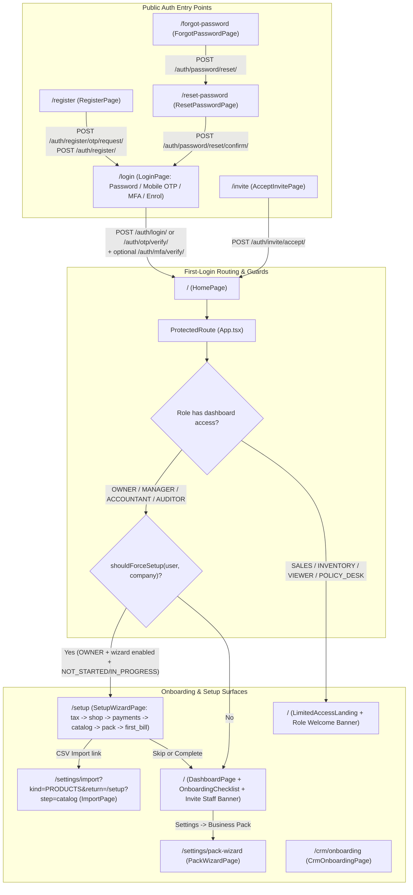
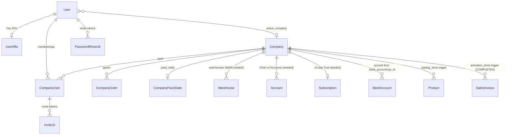

# Bizboard — Onboarding Codebase Map (`ONBOARDING_CODEBASE_MAP.md`)

**Audit Date:** 2026-10-21  
**Scope:** End-to-End User & Tenant Onboarding (Registration, OTP, Login, MFA, Invitations, Password Recovery, Setup Wizard, Archetype Packs, First-Login Routing, Dashboard Checklist, Settings Hub, CRM Onboarding, and Tenant Switching)

---

## 1. Architecture Summary

Bizboard is a multi-tenant Indian GST billing, inventory, accounting, and business operations platform built with:

- **Backend:** Django 6.0 + Django REST Framework (`backend/`), SimpleJWT with `httpOnly` cookie session tokens (`bb_access`, `bb_refresh`) + double-submit CSRF protection (`/api/v1/auth/csrf/`), PostgreSQL (or SQLite in fast tests), Celery outbox/tasks, and per-tenant feature flags (`core.services.feature_flags`).
- **Frontend:** React 18 + TypeScript + Vite 5 + MUI v5 + TanStack Query v5 + React Router v6 (`web/`), with bilingual English/Hindi localization (`web/src/i18n/en.ts`, `web/src/i18n/hi.ts`) and optional mock mode (`VITE_USE_MOCKS=true`).
- **Onboarding State Machine:** Derived dynamically on the server in `backend/accounts/onboarding.py` (`derive_onboarding(company)`) rather than relying solely on a static step column. It combines persisted timestamps on `Company` (`onboarding_started_at`, `onboarding_completed_at`, `onboarding_dismissed_at`, `tax_profile_confirmed_at`) with live domain state (`address`, `bank_account`/`upi_id`, `Product` count, and `SalesInvoice(status='COMPLETED')` existence).

---

## 2. Relevant File and Directory Inventory

### 2.1 Backend (`backend/`)
| File Path | Responsibility in Onboarding |
|---|---|
| `backend/accounts/urls_auth.py` | Public & session auth routes under `/api/v1/auth/` (register, OTP, login, refresh, logout, MFA, password reset, invite accept, memberships, switch-company). |
| `backend/accounts/urls_company.py` | Tenant setup & configuration routes under `/api/v1/company/` (company profile, GSTIN/PAN/Udyam verification, pack wizard, nav-scope, settings health, users, GSTINs, statutory licences, erase). |
| `backend/accounts/models.py` | Core identity & tenant models: `User`, `UserMfa`, `Company`, `CompanyGstin`, `CompanyStatutoryLicence`, `CompanyUser`, `InviteJti`, `PasswordResetJti`, `OtpChallenge`, `CompanyPackState`, `TenantErasureLog`. |
| `backend/accounts/onboarding.py` | `derive_onboarding(company)` and `should_force_setup(company, is_owner, wizard_enabled)` — canonical server-side onboarding state derivation. |
| `backend/accounts/views.py` | All auth, registration, OTP, invite, password reset, and company profile views (`RequestRegisterOtpView`, `RegisterView`, `LoginView`, `RequestOtpView`, `VerifyOtpView`, `AcceptInviteView`, `CompanyDetailView`, `CompanyUserViewSet`, etc.). |
| `backend/accounts/serializers.py` | `RegisterSerializer` (atomic User + Company + Owner `CompanyUser` + `CompanyGstin` + default `Warehouse` + Chart of Accounts + Trial Subscription creation), `CompanySerializer` (handles `mark_onboarding_started`, `confirm_tax_profile`, `dismiss_onboarding`, GSTIN/bank validation, `sync_company_bank_account`), `InviteUserSerializer`, `MeSerializer`. |
| `backend/accounts/mfa.py` & `mfa_service.py` & `mfa_views.py` | TOTP secret encryption, QR generation, recovery code hashing, login challenge tokens (`mfa_token`), forced money-role enrolment tokens (`enrol_token`), and `/auth/mfa/*` endpoints. |
| `backend/accounts/otp_utils.py` | HMAC-SHA256 OTP hashing (`OTP_PEPPER`), Indian mobile E.164 normalization (`normalize_e164`), `phone_taken`, and `resolve_user_by_phone`. |
| `backend/accounts/packs.py` & `pack_views.py` | Business archetype pack definitions (`retail`, `trade`, `distribution`, `manufacturing`, `insurance`), `propose_pack`, `pack_preview`, `apply_pack`, `NavScopeView`, and `PackWizardView`. |
| `backend/accounts/settings_health.py` | `settings_health(company)` and `SettingsHealthView` (`/api/v1/company/settings-health/`) driving the `/settings` attention badges. |
| `backend/core/services/registration_gates.py` | `assert_may_issue_gst_tax_invoice` — blocks `REGULAR` without GSTIN, `COMPOSITION`, and `UNREGISTERED` companies from completing GST tax invoices. |
| `backend/core/services/feature_flags.py` | `build_feature_flags(company, user)` — merges deployment env flags, subscription plan entitlements (`trial_plan_modules`), and `Company.feature_flags` JSON (`ENABLE_SETUP_WIZARD`, `ENABLE_ARCHETYPE_PACKS`, `NAV_PACK_DEFAULT`, etc.). |
| `backend/core/validators.py` | `validate_gstin`, `validate_pan`, `validate_ifsc`, `validate_pincode`, `validate_upi_id`, `gstin_state_name`. |
| `backend/billing/services.py` | `ensure_register_trial(company)` and `plan_modules_for_company(company)` — seeds a 14-day `TRIAL` subscription on signup. |
| `backend/accounting/services.py` | `ChartOfAccountsService.initialize_default_accounts(company)` — seeds default ledger accounts during registration. |
| `backend/payments/services.py` | `sync_company_bank_account(company)` and `invoice_bank_details(company)` — syncs `Company` bank/UPI fields to `payments.BankAccount`. |
| `backend/crm/models.py` & `crm/views.py` | `CustomerOnboarding` & `CustomerOnboardingStep` models and `/api/v1/crm/onboarding/` viewset (post-win B2B customer onboarding tracker). |

### 2.2 Frontend (`web/src/`)
| File Path | Responsibility in Onboarding |
|---|---|
| `web/src/App.tsx` | Route definitions, `ProtectedRoute`, `RoleRoute`, and `settingsRoute`. |
| `web/src/auth/AuthContext.tsx` | Session bootstrap (`ensureCsrfCookie`, `refreshAccessToken`, `fetchCurrentUser`, `fetchFeatureFlags`), `login`, `loginWithOtp`, `completeMfaLogin`, `register`, `logout`, and cross-tab storage sync. |
| `web/src/api/client.ts` | Axios instance, CSRF cookie/body fallback, `X-Company-Id` header injection, 401 refresh interceptor, and `memoryEnrolToken` handling. |
| `web/src/api/auth.ts` | Auth API wrappers, `MfaRequiredError`, `MfaEnrollmentRequiredError`, and mock persona resolution (`mockUserForEmail`). |
| `web/src/onboarding/shouldForceSetup.ts` | Frontend guard deciding whether an `OWNER` is redirected to `/setup`. |
| `web/src/onboarding/taxHints.ts` | Client-side GSTIN format check and state prefix vs selected state mismatch warning (`gstinStateMismatch`). |
| `web/src/onboarding/analytics.ts` | `trackOnboardingEvent` -> `POST /api/v1/insights/events/` (`journey: 'signup'`). |
| `web/src/pages/RegisterPage.tsx` | New tenant & owner registration (`/register`) with mandatory pre-signup email OTP verification. |
| `web/src/pages/LoginPage.tsx` | Password login, Mobile OTP login, TOTP/Recovery MFA step, and inline forced MFA enrolment (`/login`). |
| `web/src/pages/ForgotPasswordPage.tsx` | Password reset request (`/forgot-password`). |
| `web/src/pages/ResetPasswordPage.tsx` | Password reset confirmation (`/reset-password?token=...`). |
| `web/src/pages/AcceptInvitePage.tsx` | Team invitation acceptance and account activation (`/invite?token=...`). |
| `web/src/pages/setup/SetupWizardPage.tsx` | Guided 5/6-step owner onboarding wizard (`/setup`). |
| `web/src/pages/HomePage.tsx` | Root route dispatcher (`/`): routes `OWNER`/`MANAGER`/`ACCOUNTANT`/`AUDITOR` to `DashboardPage` (or `/setup` if forced) and operational roles to `LimitedAccessLanding`. |
| `web/src/pages/DashboardPage.tsx` | Renders `OnboardingChecklist` when setup is incomplete and the post-activation `Invite staff` banner (`bb_invite_nudge_dismissed`). |
| `web/src/components/OnboardingChecklist.tsx` | 4-step interactive checklist card on the dashboard (`Shop Details & GSTIN`, `Bank Account & UPI QR`, `Add Products & Stock`, `Create Your First Bill`). |
| `web/src/pages/LimitedAccessLanding.tsx` | Role-appropriate landing page for invited non-dashboard staff (`SALES`, `INVENTORY`, `VIEWER`, `POLICY_DESK`) with first-visit welcome alert (`bb_role_welcome`). |
| `web/src/pages/settings/PackWizardPage.tsx` | Standalone Business Archetype Pack wizard (`/settings/pack-wizard`). |
| `web/src/pages/settings/SettingsHubPage.tsx` | Settings landing page (`/settings`) with `settings-health` status chips (`TODO`/`WARN`/`OK`). |
| `web/src/pages/settings/CompanySettingsPage.tsx` | Company profile & shop address settings (`/settings/company`). |
| `web/src/pages/settings/GstSettingsPage.tsx` | GST registration type, primary GSTIN, additional GSTINs, e-Invoice/e-Way sandbox, and statutory licences (`/settings/gst`). |
| `web/src/pages/settings/BankAccountsPage.tsx` | Bank accounts & invoice bank/UPI settings (`/settings/bank-accounts`). |
| `web/src/pages/settings/UsersSettingsPage.tsx` | Staff user management, `Invite User` modal, role/permission editor, and `TwoStepVerificationPanel` (`/settings/users`). |
| `web/src/pages/settings/ImportPage.tsx` | CSV import wizard for Products, Customers, Suppliers, Opening Stock, and Chart of Accounts (`/settings/import`), with return-link integration back to `/setup?step=catalog`. |
| `web/src/pages/crm/CrmOnboardingPage.tsx` | Post-sale customer onboarding checklist module (`/crm/onboarding`). |
| `web/src/components/CompanySwitcher.tsx` & `CompanyRequiredDialog.tsx` | Multi-company switcher in `AppShell` and staff tenant selection dialog. |

---

## 3. Complete Route & API Inventory for Onboarding

### 3.1 Frontend Routes
| Route | Component | Guard | Purpose |
|---|---|---|---|
| `/register` | `RegisterPage` | Public (redirects to `/` if authenticated) | Sign up new company + owner with email OTP |
| `/login` | `LoginPage` | Public (redirects to `state.from` or `/` if authenticated) | Email/password login, Mobile OTP login, MFA challenge, MFA enrolment |
| `/forgot-password` | `ForgotPasswordPage` | Public | Request password reset link via email or phone |
| `/reset-password` | `ResetPasswordPage` | Public | Set new password using reset token (`?token=...`) |
| `/invite` | `AcceptInvitePage` | Public | Accept staff invitation (`?token=...`) |
| `/setup` | `SetupWizardPage` | `ProtectedRoute` + `RoleRoute(['OWNER'])` | 5/6-step owner setup wizard (`?step=tax\|shop\|payments\|catalog\|pack\|first_bill`) |
| `/` | `HomePage` -> `DashboardPage` or `LimitedAccessLanding` | `ProtectedRoute` | Role-aware home workspace; redirects Owner to `/setup` when `shouldForceSetup` is true |
| `/settings` | `SettingsHubPage` | `ProtectedRoute` + `settingsRoute` | Settings overview with `settings-health` checklist badges |
| `/settings/pack-wizard` | `PackWizardPage` | `ProtectedRoute` + `RoleRoute(['OWNER'])` | Archetype pack questionnaire, preview, and apply |
| `/settings/company` | `CompanySettingsPage` | `ProtectedRoute` + `settingsRoute` | Shop address, legal name, state, negative stock policy |
| `/settings/gst` | `GstSettingsPage` | `ProtectedRoute` + `settingsRoute` | GST registration type, GSTIN verification, additional GSTINs |
| `/settings/bank-accounts` | `BankAccountsPage` | `ProtectedRoute` + `settingsRoute` | Bank accounts & UPI QR configuration |
| `/settings/users` | `UsersSettingsPage` | `ProtectedRoute` + `settingsRoute` | Invite staff, manage roles, configure 2FA (`TwoStepVerificationPanel`) |
| `/settings/import` | `ImportPage` | `ProtectedRoute` + `settingsRoute` | Bulk CSV import (linked from Setup Wizard Step 4) |
| `/crm/onboarding` | `CrmOnboardingPage` | `ProtectedRoute` (`ENABLE_CRM`) | Track post-deal customer onboarding steps |

### 3.2 Backend Endpoints
| Method & Path | View | Auth / Permission |Throttling | Description |
|---|---|---|---|---|
| `GET /api/v1/auth/csrf/` | `CsrfCookieView` | `AllowAny` | Default | Sets `csrftoken` cookie and returns `{csrfToken}` in body |
| `POST /api/v1/auth/register/otp/request/` | `RequestRegisterOtpView` | `AllowAny` | `AuthBurstThrottle`, `OtpRequestEmailRateThrottle` | Sends 6-digit signup OTP to email (`OtpChallenge(purpose='REGISTER')`) |
| `POST /api/v1/auth/register/` | `RegisterView` | `AllowAny` | `AuthBurstThrottle`, `RegisterRateThrottle` (10/hr/IP) | Verifies signup OTP, creates `User`, `Company`, `CompanyUser(OWNER)`, `Warehouse`, COA, Trial Subscription |
| `POST /api/v1/auth/login/` | `LoginView` | `AllowAny` | `AuthBurstThrottle`, `LoginRateThrottle` (10/min/IP) | Validates email/password; returns JWT cookies, `mfa_required`, or `mfa_enrollment_required` |
| `POST /api/v1/auth/otp/request/` | `RequestOtpView` | `AllowAny` | `AuthBurstThrottle`, `OtpRequestPhoneRateThrottle` | Sends 6-digit login OTP to registered mobile number |
| `POST /api/v1/auth/otp/verify/` | `VerifyOtpView` | `AllowAny` | `AuthBurstThrottle`, `OtpVerifyPhoneRateThrottle` | Verifies mobile OTP; returns JWT cookies, `mfa_required`, or `mfa_enrollment_required` |
| `POST /api/v1/auth/mfa/verify/` | `MfaLoginVerifyView` | `AllowAny` (uses `mfa_token`) | `AuthBurstThrottle`, `LoginRateThrottle` | Completes 2FA login with TOTP code or recovery code |
| `GET /api/v1/auth/mfa/status/` | `MfaStatusView` | `IsAuthenticated` | Default | Returns 2FA status and remaining recovery code count |
| `POST /api/v1/auth/mfa/setup/` | `MfaSetupView` | `IsAuthenticated` OR `enrol_token` | `AuthBurstThrottle`, `LoginRateThrottle` | Generates TOTP secret, `otpauth://` URI, and QR PNG data URI |
| `POST /api/v1/auth/mfa/confirm/` | `MfaConfirmView` | `IsAuthenticated` OR `enrol_token` | `AuthBurstThrottle`, `LoginRateThrottle` | Verifies TOTP code, enables `UserMfa`, returns 10 recovery codes |
| `POST /api/v1/auth/refresh/` | `CookieTokenRefreshView` | Cookie `bb_refresh` | `TokenRefreshRateThrottle` | Rotates refresh token and issues new access token cookie |
| `GET /api/v1/auth/me/` | `MeView` | `IsAuthenticated` | Default | Returns current `User` profile, active company ID, role, and capabilities |
| `GET /api/v1/auth/memberships/` | `MembershipsListView` | `IsAuthenticated` | Default | Lists active `CompanyUser` memberships for multi-company switching |
| `POST /api/v1/auth/switch-company/` | `SwitchCompanyView` | `IsAuthenticated` | Default | Updates `user.active_company` |
| `POST /api/v1/auth/password/reset/` | `RequestPasswordResetView` | `AllowAny` | `AuthBurstThrottle`, `PasswordResetRequestThrottle` | Creates `PasswordResetJti` and emails reset link |
| `POST /api/v1/auth/password/reset/confirm/` | `ConfirmPasswordResetView` | `AllowAny` | `AuthBurstThrottle`, `PasswordResetConfirmThrottle` | Consumes `PasswordResetJti`, updates password, bumps `token_version` |
| `POST /api/v1/auth/invite/accept/` | `AcceptInviteView` | `AllowAny` | `AuthBurstThrottle`, `InviteAcceptRateThrottle` | Consumes `InviteJti`, sets password (for new user) or verifies password (for existing user), activates `CompanyUser` |
| `GET / PATCH /api/v1/company/` | `CompanyDetailView` | `IsAuthenticated`, `HasCompany` (`IsOwner` for PATCH) | Default | Reads/updates `Company`, returns derived `onboarding` state, handles `mark_onboarding_started`, `confirm_tax_profile`, `dismiss_onboarding` |
| `POST /api/v1/company/verify-gstin/` | `CompanyVerifyGstinView` | `IsAuthenticated`, `HasCompany`, `IsOwner` | Default | Verifies GSTIN structure/checksum and records `gstin_verified_at` |
| `GET / POST /api/v1/company/pack-wizard/` | `PackWizardView` | `IsAuthenticated`, `HasCompany` (`IsOwner` for POST) | Default | Previews (`action='propose'`) or applies (`action='confirm'`) an archetype feature-flag pack |
| `GET / POST /api/v1/company/nav-scope/` | `NavScopeView` | `IsAuthenticated`, `HasCompany` | Default | Gets or toggles sidebar navigation scope (`pack` vs `all`) |
| `GET /api/v1/company/settings-health/` | `SettingsHealthView` | `IsAuthenticated`, `HasCompany`, `IsOwner` | Default | Returns `todo`/`warn`/`ok` status for GSTIN, tax profile, bank, licences, gateway, users |
| `POST /api/v1/company/users/invite/` | `CompanyUserViewSet.invite` | `IsAuthenticated`, `HasCompany`, `IsOwner` | Default | Creates/reuses `User` + inactive `CompanyUser` + `InviteJti` and sends invite email |
| `GET /api/v1/feature-flags/` | `FeatureFlagsView` | `IsAuthenticated` | Default | Returns merged runtime feature flags for active company |
| `POST /api/v1/insights/events/` | `ShopFloorEventView` | `IsAuthenticated`, `HasCompany` | Default | Records onboarding telemetry events (`wizard_started`, `wizard_tax_confirmed`, `wizard_completed`, etc.) |

---

## 4. Data Model Relationships

### Key Onboarding Side-Effects on `POST /api/v1/auth/register/` (`RegisterSerializer.create`)
Inside a single `@transaction.atomic` block (`backend/accounts/serializers.py:135-238`):
1. Consumes the latest matching `OtpChallenge(purpose='REGISTER', phone=email.lower())`.
2. Creates `Company` with `feature_flags={"NAV_PACK_DEFAULT": True}` (plus optional `gstin` and `state`).
3. Creates `CompanyGstin(company=company, gstin=gstin, state_code=gstin[:2], is_primary=True)` if `gstin` was provided.
4. Creates `User(email=..., phone=..., active_company=company)` with hashed password.
5. Creates `CompanyUser(user=user, company=company, role='OWNER', is_active=True)`.
6. Seeds default `Warehouse(company=company, name='Main Warehouse', code='MAIN', is_default=True)`.
7. Calls `ChartOfAccountsService.initialize_default_accounts(company)` to create default accounting ledgers.
8. Calls `ensure_register_trial(company)` to create the `Plan(slug='trial')` (if absent) and a 14-day `Subscription(status='TRIAL')`.

---

## 5. Authentication & Authorization Boundaries

1. **Public vs Authenticated:**
   - `/register`, `/login`, `/forgot-password`, `/reset-password`, and `/invite` are public routes using `AllowAny` endpoints protected by IP and identifier rate throttles (`AuthBurstThrottle`, `RegisterRateThrottle`, `LoginRateThrottle`, `OtpRequest*Throttle`, `InviteAcceptRateThrottle`).
   - Registration (`POST /api/v1/auth/register/`) **never issues JWT cookies** (anti-enumeration design R-068 / BB-000251); the user must sign in on `/login` afterward.
2. **Session Management & CSRF:**
   - In cookie mode (`JWT_AUTH_COOKIE_ONLY=True` in production), `bb_access` and `bb_refresh` are `httpOnly` cookies; `apiClient` automatically calls `GET /api/v1/auth/csrf/` before any mutating (`POST`/`PATCH`/`PUT`/`DELETE`) request and attaches `X-CSRFToken`.
3. **Tenant Isolation & Role Gating:**
   - `get_company_user(request)` resolves the active tenant from `X-Company-Id` header (validated against active `CompanyUser` memberships) or `request.user.active_company`.
   - `/setup` and `/settings/pack-wizard` are strictly gated to `OWNER` (`RoleRoute(['OWNER'])` on frontend, `IsOwner` on backend `PATCH /api/v1/company/` and `POST /api/v1/company/pack-wizard/`).
   - Non-owner roles (`MANAGER`, `ACCOUNTANT`, `AUDITOR`, `SALES`, `INVENTORY`, `VIEWER`, `POLICY_DESK`) are **never** forced into `/setup` (`shouldForceSetup` checks `user.role === 'OWNER'`).

---

## 6. Existing Automated Tests & Coverage Gaps

### Executed Automated Tests
- **Backend (`pytest`):**
  - `backend/tests/test_onboarding.py` (10 tests — `derive_onboarding`, `should_force_setup`, dismiss, tax confirmation, backfill, archetype packs, trial plan modules)
  - `backend/tests/personas/test_pj_ftue_onboarding_and_help.py` (3 end-to-end persona tests — founder FTUE stepper, invited staff landing, help error code resolution)
  - `backend/tests/test_auth.py`, `backend/tests/test_mfa.py`, `backend/tests/test_mfa_edge_cases.py`, `backend/tests/test_settings_ai_and_packs.py`, `backend/tests/test_settings_users.py`, `backend/tests/matrices/test_company_settings_matrix.py`
- **Frontend (`vitest`):**
  - `web/src/pages/RegisterPage.test.tsx` (4 tests)
  - `web/src/pages/LoginPage.mfa.test.tsx` (10 tests)
  - `web/src/pages/loginOtp.test.ts` (2 tests)
  - `web/src/pages/setup/SetupWizardPage.test.tsx` (9 tests)
  - `web/src/pages/setup/SetupWizardPackStep.test.tsx` (1 test)
  - `web/src/onboarding/taxHints.test.ts` (3 tests)
  - `web/src/pages/AcceptInvitePage.test.tsx`, `web/src/pages/settings/UsersInvites.test.tsx`, `web/src/pages/settings/PackWizardPage.test.tsx`, `web/src/components/PasswordField.test.tsx`
- **Playwright E2E (`web/e2e/`):**
  - `web/e2e/auth-recovery.spec.ts` (forgot-password & reset-password smoke)
  - `web/e2e/route-smoke-unauthenticated.spec.ts` (20 protected routes redirect to `/login`)

### Key Coverage Gaps Identified
1. **No E2E/integration test verifies clicking "Go to Dashboard" after Step 5 (`first_bill`) in `SetupWizardPage.tsx`:** Existing unit test `SetupWizardPage.test.tsx:81` only checks that `createSalesInvoice` is called and `completeSalesInvoice` is NOT called, missing the fact that `derive_onboarding` stays `IN_PROGRESS` and `HomePage`/`DashboardPage` bounces the Owner back to `/setup` in an infinite loop!
2. **No test covers `COMPOSITION` with empty GSTIN through `SetupWizardPage.tsx` -> `CompanySerializer`:** Frontend allows blank GSTIN for Composition, while `CompanySerializer.validate` rejects it with HTTP 400.
3. **No test covers completing the full forced MFA enrolment flow on `LoginPage.tsx` through recovery-code acknowledgement to actual sign-in:** `LoginPage.mfa.test.tsx:110` only asserts that the heading "Set up two-step verification" appears, missing both the absent QR code image and the dead-end screen after clicking "I have saved them".
4. **No test covers `RegisterView` when a new email + valid OTP is submitted with an already-taken phone number:** Silently returns HTTP 200 OK without creating the user, leading to immediate login failure.

---

## 7. External Dependencies & Environment Configuration
- **Feature Flags Affecting Onboarding:**
  - `VITE_ENABLE_SETUP_WIZARD` (frontend env flag, default `'false'` unless set to `'true'` in `.env`) and `ENABLE_SETUP_WIZARD` (backend setting/feature flag, default `False` in `settings.py:554`). Note: `shouldForceSetup` on the frontend checks `isSetupWizardEnabled()`, which reads `import.meta.env.VITE_ENABLE_SETUP_WIZARD === 'true'`, NOT the runtime `/api/v1/feature-flags/` response!
  - `ENABLE_ARCHETYPE_PACKS` (runtime feature flag, default `False` in `settings.py:576`, granted in `ROLLOUT_GRANTABLE_KEYS` / `trial_plan_modules()`).
  - `MFA_ENFORCE_FOR_MONEY_ROLES` (backend setting, `True` when `BIZBOARD_PROFILE=pilot`, forcing `OWNER` and `ACCOUNTANT` to enrol in TOTP MFA before any session is issued).
  - `OTP_DEBUG_ECHO` (dev/test only; forbidden when `DEBUG=False`).
- **External Gateways:**
  - Email delivery uses Django's configured `EMAIL_BACKEND` (`send_mail` with `fail_silently=True` for OTP, invites, and password resets).
  - GSTIN / PAN / Udyam verification in `/api/v1/company/verify-*` validates structural checksums locally (no external live GSTN API call required).
