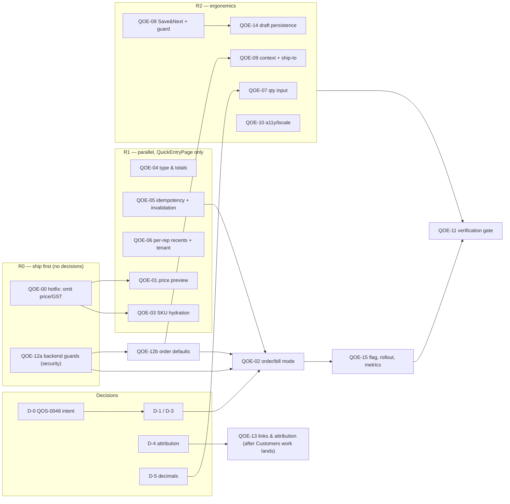

# Screen, Flow & Product Impact Review: Quick Order Entry (`/sales/quick-entry`)

**Date:** 2026-10-12  
**Reviewed Module:** [`QuickEntryPage`](../web/src/pages/sales/QuickEntryPage.tsx) (`web/src/pages/sales/QuickEntryPage.tsx`)  
**Test Suite:** [`QuickEntryPage.test.tsx`](../web/src/pages/sales/QuickEntryPage.test.tsx) (`web/src/pages/sales/QuickEntryPage.test.tsx`)  
**Backlog Origin:** [`QOS-0048.yaml`](../qos/backlog/QOS-0048.yaml) (`qos/backlog/QOS-0048.yaml`)  
**Related Backend & Frontend Surfaces:**
- [`SalesInvoiceSerializer`](../backend/sales/serializers.py) (`backend/sales/serializers.py`)
- [`SalesService`](../backend/sales/services.py) (`backend/sales/services.py`)
- [`resolve_unit_price` / `resolve_party_price`](../backend/masters/pricing.py) (`backend/masters/pricing.py`)
- [`InvoiceDetailPage`](../web/src/pages/sales/InvoiceDetailPage.tsx) (`web/src/pages/sales/InvoiceDetailPage.tsx`)
- [`SalesOrderEditorPage`](../web/src/pages/sales/SalesOrderEditorPage.tsx) (`web/src/pages/sales/SalesOrderEditorPage.tsx`)
- [`SalesOrdersPage`](../web/src/pages/sales/SalesOrdersPage.tsx) (`web/src/pages/sales/SalesOrdersPage.tsx`)
- [`invalidateInvoiceSideEffects`](../web/src/pages/sales/invalidateInvoiceSideEffects.ts) (`web/src/pages/sales/invalidateInvoiceSideEffects.ts`)

---

## 0. Revision Notes (post-review, 2026-10-12)

This document was reviewed and revised. Summary of what changed and why:

| # | Review comment | Resolution in this document |
|---|---|---|
| 1 | D-1 (Order vs Draft Invoice) left open; confirmation/gate behaviour of a draft `SalesOrder` undefined; QOS-0048 intent unchecked | §21.1: D-1 now has a pre-step (read QOS-0048 acceptance criteria) and new **D-3** (who confirms, gate-block behaviour) |
| 2 | Backend `SalesOrder` gaps are a standalone security bug, not part of Quick Entry; size too low | `QOE-12` split into **`QOE-12a`** (ship now, independent, size L) and **`QOE-12b`** (order-mode defaults, tied to D-1) |
| 3 | Price/GST fix over-built; two sources of truth | New **`QOE-00` hotfix** (stop sending `unitPrice`/`gstRate` unless overridden). `QOE-01`/`QOE-03` rewritten to use backend-authoritative pricing |
| 4 | Idempotency key per click defeats retry protection | `QOE-05` rewritten: one key per save *attempt*, held until success or payload change |
| 5 | Offline/draft loss, recents not per-rep, no ship-to selection | New **`QOE-14`** (draft persistence), `QOE-06` extended (per-rep recents from invoices + orders), ship-to in `QOE-09` |
| 6 | Salesman/channel attribution under-specified | `QOE-13` rewritten (user→Employee mapping, channel decision D-4) |
| 7 | Quantity ignores unit decimal rules | `QOE-07` rewritten (per-unit decimal policy) |
| 8 | No rollout/rollback/metrics/migration | New **`QOE-15`** (feature flag, rollout, metrics, comms) |
| 9 | Overlap with in-flight uncommitted Customers work; line numbers rot | §21.0 sequencing rule; line numbers now treated as hints (symbols are authoritative) |
| 10 | Priority inflation, ambiguous verdict, repetition, label drift, artificial ordering, tests last | §18 re-prioritised, Final Verdict is single-valued, §21.4 reordered, tests are per-package (`QOE-11` is now a verification gate only) |
| 11 | Unverified claims | New **§22 Verification Status** lists what was confirmed in code and what must be checked before work starts |

> **Note on line numbers:** all `file:line` references below were taken from a working tree with uncommitted changes in `sales/services.py`, `sales/notes_services.py`, `sales/serializers.py`, `Customer360Page.tsx`, `usePartySearch.ts` and others. Treat them as hints; locate by symbol name.

---

## Implementation status

Implemented 2026-10-12; see the status section in [QUICK_ORDER_ENTRY_IMPLEMENTATION_PLAN.md](QUICK_ORDER_ENTRY_IMPLEMENTATION_PLAN.md)
and the rollout notes in [QUICK_ORDER_ENTRY_ROLLOUT.md](QUICK_ORDER_ENTRY_ROLLOUT.md). The findings below describe the screen
**before** that work.

---

## 1. SCREEN PURPOSE

- **What is this screen for?**
  - **Observed:** A compact (`maxWidth: 480`), keyboard-light order-booking sheet (`web/src/pages/sales/QuickEntryPage.tsx`, lines 74–81) designed for rapid customer + SKU selection using recent customer chips, recent SKU chips, a `+`/`-` quantity stepper, and a single "Save order" CTA.
- **Who is likely to use it?**
  - **Observed:** Persona **P3 (The Traveling Order Booker / Field Sales Representative)** operating within **ARCH-03 (Semi-Wholesaler & Trade Merchant)** and **ARCH-04 (Multi-Godown Regional Stockist)** (`qos/backlog/QOS-0048.yaml`, `docs/BUSINESS_ARCHETYPES_AND_PERSONAS.md`). Access requires `canCreateSales` (`OWNER` or `user.canCreateSales === true`, excluding `VIEWER`).
- **What user problem does it solve?**
  - **Observed:** Reduces the heavy multi-panel form overhead of `NewInvoicePage` (3,259 lines) and `SalesOrderEditorPage` (768 lines) when a field rep is standing in a customer's shop or between visits on a mobile device and needs to capture a repeat order in seconds.
- **What is the primary user goal & primary action?**
  - **Observed:** Select a customer, tap/search products, adjust quantities, and tap **"Save order"** (`QuickEntryPage.tsx`, lines 289–297).
- **What should the user be able to accomplish here?**
  - **Inferred:** Quickly book a field order with accurate customer-specific pricing, stock awareness, and credit-hold awareness, and hand it off to the back office / godown for confirmation, dispatch, or billing.
- **What should NOT be handled on this screen?**
  - **Inferred:** Statutory e-Invoice/e-Way bill generation, accounting cost-center splits, batch/serial lot picking, reverse charge (RCM), TCS manual overrides, and payment settlement.
- **Is the purpose immediately clear?**
  - **No — Critical Domain Contradiction (Observed):** Every label on the screen says **"Order"** (`Quick Order Entry`, `Tap a recent item or search a product to start the order`, `Pick a customer before saving this order`, `Save order` — `web/src/i18n/en.ts`, lines 2362–2374), yet clicking **"Save order"** calls `createSalesInvoice` (`POST /sales/invoices/`) and redirects to `/sales/history/:id` (`InvoiceDetailPage`) instead of creating a `SalesOrder` (`POST /sales/orders/`) via `createSalesOrder`. Meanwhile, Bizboard has a dedicated **Sales Orders** module (`/sales/orders`) right below it in the same menu (`web/src/navigation/menu.ts`, lines 141–146).

---

## 2. USER EXPERIENCE REVIEW

| Dimension | Finding | Classification |
|---|---|---|
| **Clarity & Terminology** | Screen is named **Quick Order Entry** and button says **Save order**, but it creates a **Draft Sales Invoice** and lands the user on the **Sales Invoice Detail** page (`/sales/history/:id`). Users looking for their saved order under **Sales → More → Sales Orders** (`/sales/orders`) will never find it. | **Observed** |
| **Discoverability** | Buried under **Sales → More → Quick Order Entry** (`web/src/navigation/menu.ts`, lines 138–141). For a field rep on mobile (Persona P3), this is their primary daily tool, yet it is hidden in a secondary overflow submenu. | **Observed** |
| **Information Hierarchy** | Clean 3-part vertical stack (Customer card → Add Item card → Line list + Sticky footer). However, the sticky footer (`position: 'sticky', bottom: 8`) only renders when `lines.length > 0` (`QuickEntryPage.tsx`, line 278). | **Observed** |
| **Visual Hierarchy & Line Details** | Each line item card (`QuickEntryPage.tsx`, lines 254–273) shows only `line.name` (truncated with `noWrap`), `{unitPrice} each`, and quantity. It omits: **line total (`qty × unitPrice`)**, **unit of measure (`pcs`, `kg`, `box`)**, **SKU**, and **GST rate**. | **Observed** |
| **Affordances & Quantity Entry** | Quantity can **only** be changed by clicking `-` or `+` (`delta = 1`). The quantity number itself (`<Typography>{line.quantity}</Typography>` at `QuickEntryPage.tsx`, line 266) is not an editable input. Booking 50 units of a wholesale SKU requires **49 taps**. | **Observed** |
| **Feedback & User Confidence** | Selecting a product immediately adds/increments the line and clears the search box, but gives no toast/highlight when an existing off-screen line's quantity is bumped. Tapping `-` when `quantity === 1` **immediately deletes the line** (`QuickEntryPage.tsx`, lines 149–150) even though there is already a dedicated `<DeleteIcon />` button right next to it (lines 270–272). | **Observed** |
| **Error Prevention** | No `<UnsavedChangesGuard />` (unlike `SalesOrderEditorPage` and `NewInvoicePage`). Navigating away or hitting mobile Back loses all entered lines silently. | **Observed** |

---

## 3. COGNITIVE LOAD

- **What the user must understand & remember:**
  - **Observed:** Because recent SKU chips (`QuickEntryPage.tsx`, lines 228–230) display only `p.name` (without SKU, price, or current stock) and do not indicate which items are already added to the order, the rep must remember what they already tapped or scroll down to check.
  - **Observed:** Because neither customer credit/overdue status nor item available stock is shown on this screen, the field rep must mentally remember or open separate screens (`/sales/customers/:id`, `/inventory/stock`) to check whether the customer is on credit hold or whether items are in stock.
- **Physical / Interaction Load:**
  - **Observed:** For 1–3 unit orders, interaction load is very low (3–5 taps). For B2B wholesale quantities (10–500 units per SKU, typical of ARCH-03/ARCH-04), the lack of a direct numeric input turns a 3-keystroke action into dozens of repetitive `+` taps.
- **Opportunities to reduce cognitive & physical load:**
  1. Make the quantity display a tappable compact numeric input alongside `-`/`+`.
  2. Show a quantity badge on `recentSkus` chips for items already in `lines`.
  3. Show available stock and unit name in the product picker via `formatProductOptionLabel` (`web/src/utils/formatProductOptionLabel.ts`) and show customer credit status (`CreditHoldChip`) when a customer is selected.

---

## 4. USER FLOW

### Reconstructed Actual Flow

```text
Entry (Sidebar: Sales → More → Quick Order Entry, or direct URL /sales/quick-entry)
 ↓
Previous state: Rep is on Dashboard / Sales History / Customer page
 ↓
Current screen: QuickEntryPage (/sales/quick-entry)
  - Queries last 10 invoices (`listSalesInvoicesPage({ page: 1, pageSize: 10 })`) to build up to 6 recent customer chips
  - Loads up to 8 recent SKUs from `localStorage['bizboard:quick-entry-recent-skus:<companyId>']`
 ↓
User action:
  1. Picks customer (via Recent Customer chip OR Customer Autocomplete)
  2. Adds items (via Recent SKU chip OR Product Autocomplete)
  3. Adjusts quantities via +/- buttons
  4. Taps "Save order"
 ↓
System response:
  - Calls `createSalesInvoice({ customer, items: [{ product, quantity, unitPrice, gstRate }] })`
  - Backend creates a `DRAFT` SalesInvoice (defaulting `invoice_type='GST'`, `price_mode='EXCLUSIVE'`)
  - Invalidates ONLY `['quick-entry-recent-invoices']`
 ↓
Next screen:
  - Redirects to `/sales/history/:id` (`InvoiceDetailPage`) in DRAFT state
 ↓
Completion:
  - User is now on the full InvoiceDetailPage and must either Complete the invoice there, Edit it in `/sales/history/:id/edit`, or leave it as a Draft invoice.
```

### Flow Evaluation

- **Entry points:** Only reachable via `Sales → More → Quick Order Entry` (`menu.ts`, line 141). Does **not** accept URL query parameters like `?customer=123` or `?product=456` (whereas `SalesOrderEditorPage.tsx`, lines 148–150 supports `?customer=` and `?product=` prefill from Customer 360 / Stock pages). (**Observed**)
- **Exit / Completion mismatch for Field Reps:** A field rep booking 20 orders in a market wants **"Save & Book Next Order"** (staying on `/sales/quick-entry` with a reset form and a toast link to the saved document). Instead, `navigate('/sales/history/${invoice.id}')` (`QuickEntryPage.tsx`, line 172) forces them onto the heavy `InvoiceDetailPage` after every single order, requiring 3 clicks to get back to `/sales/quick-entry`. (**Observed**)
- **Cancellation / Back navigation:** No Cancel button; browser Back navigates away immediately without warning, losing all unsaved lines. If the user reaches `/sales/history/:id` after saving and clicks browser Back, they return to an empty `/sales/quick-entry` and may re-enter and re-submit the same order. (**Observed**)

---

## 5. FUNCTIONAL REVIEW

| Feature / Element | Status on Screen | Review Finding |
|---|---|---|
| **Customer Picker** | Present (`QuickEntryPage.tsx`, lines 189–219) | Uses `useCustomerSearch` (`minChars: 2`, `activeOnly: true`). Once picked, collapses into a deletable `<Chip color="primary" />`. However, no helper text is shown when typing 1 character (`minChars: 2`). (**Observed**) |
| **Product Picker** | Present (`QuickEntryPage.tsx`, lines 233–246) | Uses `useProductSearch` (`minChars: 2`, `activeOnly: true`). Ignores `productSearch.helperText` and `productSearch.truncated` returned by the hook! Also omits `reason === 'reset'` in `onInputChange` (lines 238–240). (**Observed**) |
| **Quantity Input** | Stepper only (`QuickEntryPage.tsx`, lines 263–269) | Missing direct keyboard/numpad entry and decimal/fractional quantity support (e.g., `2.5 kg`). (**Observed**) |
| **Totals Calculation** | Pre-tax only (`QuickEntryPage.tsx`, line 156) | `const total = lines.reduce((sum, l) => sum + l.quantity * l.unitPrice, 0)`. Ignores `l.gstRate`, cess, and rounding. The "Total" shown on `QuickEntryPage` will **not match** the `grandTotal` shown 1 second later on `/sales/history/:id`! (**Observed**) |
| **Notes / Delivery Instructions** | Missing | Field reps cannot even attach a 1-line note (e.g., *"Deliver tomorrow morning"* or *"Urgent"*). (**Observed**) |
| **Loading States** | Partial | Autocompletes pass `loading={...isFetching}`, and Save button disables on `save.isPending`, but `recentInvoices` has no skeleton/loading indicator and the Save button label does not indicate saving progress. (**Observed**) |
| **Empty States** | Present (`QuickEntryPage.tsx`, lines 249–250) | Shows `<EmptyState description={t('quickEntry.empty')} />` when `lines.length === 0`. (**Observed**) |
| **Error States** | Partial (`QuickEntryPage.tsx`, line 183) | Shows `<HelpErrorAlert error={saveError} />` at the top of the page on save failure, but if the user has scrolled down a long list of items to the sticky bottom button, the top error alert may be scrolled out of view. If `recentInvoices` query fails, it fails silently. (**Observed**) |

---

## 6. DATA & STATE ANALYSIS

### Data Consumed
1. **Authenticated User (`useAuth`)**: Reads `user.companyId` and permissions (`QuickEntryPage.tsx`, lines 83–84).
2. **Recent Invoices (`listSalesInvoicesPage({ page: 1, pageSize: 10 })`)**: Extracts up to 6 unique `{ id: inv.customer, name: inv.customerName }` (`QuickEntryPage.tsx`, lines 97–114).
   - **Risk (Stale / Blocked Customer):** `recentInvoices` includes past invoices for customers who may **now be `BLOCKED` or `INACTIVE`**! While `useCustomerSearch` filters `status: 'ACTIVE'`, `recentCustomers` does **not**. Clicking a recent chip for a blocked customer succeeds in the UI and then fails on save with `400 Cannot create an invoice for blocked customer` (`backend/sales/serializers.py`, lines 398–408). (**Observed**)
   - **Risk (Cross-Tenant Cache Leak on Company Switch — key is confirmed missing `companyId`; exploitability is UNVERIFIED, see §22 item V-3):** Look at the query key at `QuickEntryPage.tsx`, line 98: `queryKey: ['quick-entry-recent-invoices']` — **it does NOT include `companyId`.** Whereas `localStorage` is scoped by `companyId` (line 44), React Query caches `['quick-entry-recent-invoices']` globally across company switches, showing Company A's recent customers to Company B until refetch! (**Observed**)
3. **Recent SKUs (`localStorage['bizboard:quick-entry-recent-skus:<companyId>']`)**:
   - **Risk (Stale Prices & GST Rates):** `saveRecentSku` (`QuickEntryPage.tsx`, lines 51–63) snapshots `{ id, name, sku, sellingPrice, gstRate }` into `localStorage` forever. If the owner updates a product's `sellingPrice` or `gstRate` or deactivates the product in `/inventory/products`, tapping the recent SKU chip uses the **stale `sellingPrice` and `gstRate` from `localStorage`**! (**Observed**)
   - **Risk (Inactive Product Re-Promotion):** When an inactive/deleted product in `localStorage` is tapped, `saveRecentSku` (line 123) immediately re-saves it to index 0 of `localStorage` before the backend rejects it on save. (**Observed**)

### Data Created
- Creates a `SalesInvoice` in `status = 'DRAFT'` with `SalesItem` rows via `POST /sales/invoices/` (`QuickEntryPage.tsx`, lines 158–168).
- **Does NOT create a `SalesOrder`**, despite the screen name.

### State Transitions & Cache Risks

```text
Unsaved Local State (QuickEntryPage)
  ↓ [Save order] → POST /sales/invoices/
SalesInvoice (status: DRAFT, number: "")
  ↓ [Redirect to /sales/history/:id (InvoiceDetailPage)]
  ↓ [Complete] → POST /sales/invoices/:id/complete/
SalesInvoice (status: COMPLETED, number: assigned)
```

- **Missing React Query Cache Invalidation (Observed):** On save success (`QuickEntryPage.tsx`, lines 169–173), `QuickEntryPage` only invalidates `['quick-entry-recent-invoices']`. It **fails to call `invalidateInvoiceSideEffects(qc, invoice.id)`** (or invalidate `['sales-invoices']`), leaving `/sales/history` and dashboard draft counts stale if the user navigates back.
- **No Idempotency Key (Observed):** `createSalesInvoice` (`web/src/api/legacy/sales.ts`, lines 49–90) accepts `{ idempotencyKey }`, and backend `SalesInvoiceViewSet.create` (`backend/sales/views.py`, lines 157–193) enforces durable `Idempotency-Key` deduplication (`BB-000610`), **only if the `Idempotency-Key` header is sent**. `QuickEntryPage` does **not** pass an `idempotencyKey`! A flaky mobile network retry or rapid double-tap before state update will create duplicate draft invoices.

---

## 7. BUSINESS LOGIC

1. **Silent Wholesale Price-List Override Bug (CRITICAL — Observed in Frontend + Backend interaction):**
   - `QuickEntryPage.tsx` (line 137) sets `unitPrice: toNumber(product.sellingPrice)` and sends `unitPrice: l.unitPrice` explicitly in `createSalesInvoice` (line 165).
   - In `backend/masters/pricing.py` (`resolve_unit_price`, lines 133–146):
     ```python
     list_price, _name = resolve_party_price(customer=customer, product=product, quantity=quantity)
     if list_price is None:
         return requested if requested is not None else fallback
     if requested is None:
         return list_price
     if requested >= list_price:
         return requested
     if (role or "").upper() == "OWNER":
         return requested
     return list_price
     ```
   - Because `product.selling_price` (catalog/retail price, e.g. ₹100) is usually **greater than** a wholesale customer's `list_price` (or quantity slab price, e.g. ₹85), passing `unitPrice: 100` in the payload satisfies `requested >= list_price` (`100 >= 85`) — **causing the backend to ignore the customer's wholesale price list and quantity slabs, overcharging the B2B customer at retail `sellingPrice`!**
   - Furthermore, if the logged-in user is `OWNER` and `sellingPrice < list_price`, `role == "OWNER"` overrides `list_price` too!
   - By contrast, `NewInvoicePage.tsx` uses `resolveListUnitPrice` (`web/src/utils/priceList.ts`) on the frontend.
   - **Nuance (verified):** the backend rule is intentional (comment `B8-031`: pricing *above* list is a legitimate negotiated rate for any role; only undercutting is clamped). The defect is therefore in the **client**, which sends an *implicit* catalog price as if it were a deliberate override. The same applies to `gstRate`/cess: `_build_items` defaults them from the product master (`line.get("gst_rate", product.gst_rate)`) **only when the client omits them**, so sending a stale `localStorage` `gstRate` actively overrides the live rate. Omitting both fields is the smallest correct fix (see `QOE-00`).
2. **Hardcoded Default `invoice_type = 'GST'` Breaks Composition & Unregistered Companies (Observed):**
   - `QuickEntryPage` omits `invoiceType` and `priceMode` when calling `createSalesInvoice`.
   - On the backend (`SalesInvoice.invoice_type` in `backend/sales/models.py`, line 49), `invoice_type` defaults to `'GST'` and `price_mode` defaults to `'EXCLUSIVE'`.
   - Unlike `NewInvoicePage` and `SalesOrderEditorPage` which call `preferredInvoiceType(company.registrationType)` and `chooseInvoiceDefaults`, `QuickEntryPage` creates a `GST` invoice even for `COMPOSITION` or `UNREGISTERED` companies! When they later click **Complete** on `/sales/history/:id`, `assert_may_issue_gst_tax_invoice` (`backend/sales/services.py`, line 1069) blocks completion!
3. **Total Displayed Excludes GST & Ignores Tax-Inclusive Pricing (Observed):**
   - `const total = lines.reduce((sum, l) => sum + l.quantity * l.unitPrice, 0)` (`QuickEntryPage.tsx`, line 156) sums only `quantity * unitPrice` without GST (`gstRate`) or Cess (`cessRate` / `cessAmount`).
   - (EXCLUSIVE price mode; in INCLUSIVE mode the totals can coincide but the screen still shows no tax breakup.) For a ₹1,000 item with 18% GST, `QuickEntryPage` tells the customer/rep **Total: ₹1,000.00**, and 1 second after clicking "Save order", `InvoiceDetailPage` shows **Grand Total: ₹1,180.00**.

---

## 8. CROSS-SCREEN IMPACT

| Dependent Screen | What Changes | Where It Changes | Why It Matters |
|---|---|---|---|
| **Invoice Detail Page** (`/sales/history/:id`) | Receives the newly created `DRAFT` `SalesInvoice` immediately via `navigate()` | `QuickEntryPage.tsx` (line 172) → `InvoiceDetailPage.tsx` | If `invoice_type` was defaulted to `GST` for a Composition/Unregistered company or B2C retail customer, or if batch/serial/licence fields are required on Complete, completion on `InvoiceDetailPage` will fail until the user opens the full editor (`/sales/history/:id/edit`). |
| **Sales History List** (`/sales/history`) | A new `DRAFT` invoice row (`Draft #ID`) is added in the backend | `SalesHistoryPage.tsx` (lines 93–96) | Because `QuickEntryPage` does not invalidate `['sales-invoices']`, navigating back to `/sales/history` shows stale list results. Also, uncompleted quick orders clutter Sales Invoice History as `Draft #ID` rows. |
| **Sales Orders List** (`/sales/orders`) & **Sales Order Editor** (`/sales/orders/:id`) | **Nothing changes** currently (0 records created); once wired to `SalesOrder`, new orders land here in `DRAFT` or `CONFIRMED` status | `SalesOrdersPage.tsx`, `SalesOrderEditorPage.tsx` | Dispatchers and godown staff who use `/sales/orders` to run credit/margin gate checks (`checkSalesOrderGate`), confirm orders (`confirmSalesOrder`), or convert orders to Delivery Challans **cannot see anything booked via "Quick Order Entry"** today. |
| **Delivery Routes Page** (`/sales/delivery-routes`) | **Nothing changes** currently (`RouteService.add_orders` only accepts `SalesOrder` IDs); if `SalesOrder` is created without `delivery_address`, route stops have empty addresses | `DeliveryRoutesPage.tsx`, `backend/sales/route_service.py` (lines 63, 75) | `RouteService.rollup` reads `s.sales_order.delivery_address` to build the driver's stop manifest. If Quick Entry doesn't default `delivery_address` from the customer's default shipping address (`CustomerShippingAddress`) or billing address, every route stop booked from Quick Entry has a blank address! |
| **Customer 360 Page** (`/sales/customers/:id`) | Draft invoice / order appears under customer's activity once cache refreshes; currently lacks a "Quick Order" launch button | `Customer360Page.tsx` (lines 169–175) | Not invalidated on save because `invalidateInvoiceSideEffects` is not called. Also, `Customer360Page` has `New Invoice` (`/sales/new?customer=${customerId}`) and `Repeat Last Invoice`, but no **Quick Order** shortcut (`/sales/quick-entry?customer=${customerId}`). |
| **Current Stock, Low Stock, Demand Forecast & Purchase Planning** (`/inventory/stock`, `/inventory/low-stock`, `/inventory/demand-forecast`, `/purchases/planning`) | **Zero stock reservation** when saving a `DRAFT` `SalesInvoice`; whereas confirming a `SalesOrder` increments `StockBalance.reserved_quantity` | `CurrentStockPage.tsx`, `LowStockPage.tsx`, `DemandForecastPage.tsx`, `PurchasePlanningPage.tsx` | Standalone `DRAFT` invoices do not reserve inventory (`StockBalance.reserved_quantity`), leaving warehouse and procurement screens blind to field demand until invoices are completed. |
| **Action / Attention Center & Morning Brief** (`/attention`, `/morning`) | Pending/overdue `SalesOrder`s and credit-hold/margin exceptions surface in operational queues | `AttentionPage.tsx`, `MorningPage.tsx` | Bypassing `SalesOrder` hides unfulfilled field orders from operational dispatch and morning briefing views. |

---

## 9. CROSS-MODULE / PRODUCT IMPACT

A deep audit across `backend/sales/`, `backend/masters/`, `backend/inventory/`, `backend/accounting/`, `backend/reports/`, and `docs/CROSS_FLOW_IMPACT_MAP.md` reveals **12 cross-module impacts** (including 3 newly uncovered backend parity/security gaps on `SalesOrder` that **must** be fixed as part of wiring Quick Order Entry to `SalesOrder`):

| # | Module / System | Impact Level | Detailed Cross-Module Finding & Code Reference |
|---|---|---|---|
| 1 | **Sales Orders, Delivery Challans & Dispatch (`sales.SalesOrder`, `DeliveryChallan`, `DeliveryRoute`)** | **HIGH** | **Architectural split:** "Quick Order Entry" bypasses `SalesOrder` completely. Orders booked here cannot go through `gate-check` (`checkSalesOrderGate`), `confirm` (`confirm_sales_order`), `convert-to-challan` (`convert_sales_order_to_challan`), or `DeliveryRoute` planning (`RouteService.add_orders` in `backend/sales/route_service.py:75` only accepts `SalesOrder` IDs). |
| 2 | **Backend Customer Status Gate Gap on `SalesOrder` & `DeliveryChallan` (`backend/sales/phase1_serializers.py`, `notes_services.py`)** | **HIGH (New Discovery)** | While `SalesInvoiceSerializer.validate_customer` (`backend/sales/serializers.py:398`) and `QuotationSerializer.validate_customer` (`serializers.py:872`) block `BLOCKED` and `INACTIVE` customers on `create`/`update`, **`SalesOrderSerializer.validate_customer` (`phase1_serializers.py:242-244`) and `DeliveryChallanSerializer.validate_customer` (`phase1_serializers.py:338-340`) only call `self.check_company_ref(customer, "customer")`!** Worse, `SalesNotesService.confirm_sales_order` (`backend/sales/notes_services.py:738-770`) does **not** check `customer.status`, allowing a `BLOCKED` or `INACTIVE` customer's `SalesOrder` to be created and confirmed (reserving stock!), failing only much later during `convert_sales_order` (`notes_services.py:804`)! |
| 3 | **Backend Subscription Gate & Idempotency Gap on `SalesOrderViewSet` (`backend/sales/phase1_views.py`)** | **HIGH (New Discovery)** | `SalesInvoiceViewSet` (`backend/sales/views.py:157-216`) enforces `SubscriptionWritesAllowed()` and durable `Idempotency-Key` deduplication (`begin_record`/`store_record` with `scope="sales_invoice_create"`). In contrast, **`SalesOrderViewSet` (`backend/sales/phase1_views.py:220-230`) and `DeliveryChallanViewSet` (`phase1_views.py:339-349`) omit `SubscriptionWritesAllowed()` on write actions** (`create`, `update`, `confirm`, `convert`, etc.) and `SalesOrderViewSet.create` ignores the `Idempotency-Key` header! Switching Quick Entry to `createSalesOrder` without fixing `SalesOrderViewSet` would open a subscription write bypass and lose server-side retry deduplication. |
| 4 | **Multi-GSTIN Intra-State vs. Inter-State Tax Split on `SalesOrder` (`backend/sales/notes_services.py`)** | **HIGH (New Discovery)** | `SalesService.set_items` (`backend/sales/services.py:849-856`) passes `seller_state=(getattr(invoice.company_gstin, "state", None) or "")` and `seller_gstin=(getattr(invoice.company_gstin, "gstin", None) or "")` to `party_intra_state`. **`SalesNotesService.set_order_items` (`backend/sales/notes_services.py:718-723`) omits `seller_state` and `seller_gstin`**, computing CGST/SGST vs. IGST against `order.company` primary state instead of the branch `order.company_gstin`! Also, `SalesOrder` creation does not auto-stamp `_single_active_company_gstin` when `company_gstin` is omitted. |
| 5 | **Credit Limit & Order Gate Exposure (`backend/sales/order_gates.py`, `accounting.LedgerService`)** | **HIGH** | `sales_order_exposure(company, customer, order)` (`backend/sales/order_gates.py:19-45`) sums `LedgerService.customer_exposure_for_credit_limit` (completed/open receivables) + `SalesOrder` rows in `DRAFT` or `CONFIRMED`. **It completely ignores standalone `DRAFT` `SalesInvoice`s!** Because `QuickEntryPage` currently creates standalone `DRAFT` `SalesInvoice`s instead of `SalesOrder`s, field reps can book unlimited `DRAFT` invoices via Quick Entry without increasing `sales_order_exposure` for credit-limit gate checks (`apply_order_gates`). |
| 6 | **Pricing & Master Data (`masters.PriceList`, `Product`, `CustomerShippingAddress`)** | **HIGH** | Passing `unitPrice: toNumber(product.sellingPrice)` from client-side state (or stale `localStorage`) overrides customer wholesale price lists whenever `sellingPrice >= list_price` (`backend/masters/pricing.py:142-143`). Additionally, omitting `delivery_address` and `payment_terms_days` when creating an order ignores `Customer.payment_terms_days` and default `CustomerShippingAddress` (`is_default=True`), leaving downstream `DeliveryRoute` stops (`route_service.py:63`) without a delivery address. |
| 7 | **Inventory Reservation & Procurement Planning (`inventory.InventoryService`, `StockBalance`)** | **HIGH** | Confirming a `SalesOrder` (`notes_services.py:758-760`) calls `InventoryService.reserve_stock(order.company, warehouse, item.product, item.quantity, user)`, which increments `StockBalance.reserved_quantity` and reduces available stock across Inventory & Purchase Planning. Creating a standalone `DRAFT` `SalesInvoice` reserves **zero** stock until `SalesService.complete` is called, creating a blind spot between field order booking and godown stock availability. |
| 8 | **Margin Gate & Expected Profit (`backend/sales/expected_profit.py`, `order_gates.py`)** | **MEDIUM** | `estimate_sales_order_profit` (`backend/sales/expected_profit.py:58-90`) and `order_margin_below_floor` (`order_gates.py:48-68`) evaluate line margins against `company.min_margin_percent` using `StockBalance.weighted_avg_cost` or `product.cost_price`. Orders booked as `DRAFT` `SalesInvoice`s skip `apply_order_gates` (`credit_hold` / `pending_margin_approval`). |
| 9 | **Statutory / GST Compliance (`backend/sales/services.py`, `statutory`)** | **MEDIUM** | Omitting `invoiceType` stamps `invoice_type='GST'` on every draft regardless of `company.registrationType` (`COMPOSITION`, `UNREGISTERED`) or customer B2C status (`RETAIL`). |
| 10 | **Payroll / Field Sales Attribution & Reports (`SalesInvoice.salesperson` vs. `SalesOrder.salesman` & `sales_channel`)** | **MEDIUM** | `SalesInvoice` tracks `salesperson` (FK to `AUTH_USER_MODEL`, `backend/sales/models.py:115`), while `SalesOrder` tracks `salesman` (FK to `payroll.Employee`, `models.py:591`) and `sales_channel` (`WALK_IN`, `ONLINE`, `DISTRIBUTOR`, `models.py:596`). `QuickEntryPage` sets neither, losing field rep attribution and channel analytics in Sales Reports. |
| 11 | **Audit Log & Activity Trail (`audit.AuditService`)** | **LOW** | `SalesInvoiceViewSet.create` logs `sales.invoice.create` via `AuditService.log`, and `SalesOrderViewSet.create` logs `sales.order.create`, but neither records `source="quick_entry"` in metadata to distinguish mobile quick-entry bookings from full-editor bookings. |
| 12 | **Offline Outbox (`offline/invoiceDraftCache`)** | **LOW** | Explicitly out of scope per `QOS-0048.yaml`, though field reps on mobile frequently hit spotty connectivity inside wholesale markets. |

---

## 10. EDGE CASES

### Data Edge Cases
- **Product with empty SKU (`p.sku === ''`):** Product Autocomplete `getOptionLabel` renders `"Widget ()"` (`QuickEntryPage.tsx`, line 243) instead of using `formatProductOptionLabel`. (**Observed**)
- **Duplicate Product Names across Variants:** Two products named `"PVC Pipe"` with different SKUs (`1-INCH`, `2-INCH`) render **identically** in the Recent SKU chips (`label={p.name}` at line 229) and in the line item list (`{line.name}` at line 257)! The user cannot tell which variant they tapped or which line is which. (**Observed**)
- **Stale `localStorage` SKU price or deactivated SKU:** Product price changed from ₹50 to ₹65 in Master; `localStorage` chip still submits `unitPrice: 50`. Or product was marked `INACTIVE`; `localStorage` chip still lets user add it, failing only on `Save order` with `Cannot sell inactive product`, while keeping the broken chip at the top of `localStorage`. (**Observed**)
- **Blocked/Archived Customer in `recentCustomers`:** Customer from one of the last 10 invoices was subsequently blocked; chip still appears and fails on `Save order`. (**Observed**)
- **Catalog > 200 Products / > 100 Customers:** `useProductSearch` caps at 200 and `useCustomerSearch` caps at 100; typing 1 character does not trigger server search (`minChars = 2`), and no helper text is shown to explain why results are not filtering. (**Observed**)

### User Behavior Edge Cases
- **Accidental `-` tap on `quantity = 1`:** Immediately deletes the line item without confirmation (`QuickEntryPage.tsx`, lines 149–150). (**Observed**)
- **Double-click / rapid tap on "Save order":** No `idempotencyKey` passed to `createSalesInvoice` (line 160); if two mutations fire or a retry occurs, two draft invoices are created. (**Observed**)
- **Browser Back / Refresh / Sidebar click mid-order:** No `UnsavedChangesGuard`; all items are lost immediately. (**Observed**)
- **Language switch (EN ↔ HI) while on screen:** `QuickEntryPage` does not call `useLocale()` from `@/i18n`, so labels do not re-render until another state change occurs. (**Observed**)

### System & Business Behavior Edge Cases
- **Subscription expired / read-only tenant:** Backend `SubscriptionWritesAllowed` (`backend/sales/views.py`, line 216) rejects `POST /sales/invoices/` with 403/402 only *after* the user builds the entire order and clicks "Save order" (and is completely missing on `SalesOrderViewSet` in `backend/sales/phase1_views.py:226`!). (**Observed**)
- **Multi-company user switches active company:** `recentSkus` updates for the new `companyId` (`QuickEntryPage.tsx`, lines 117–120), **but** `customer` and `lines` state are **not** cleared on company switch, and `['quick-entry-recent-invoices']` query key is not keyed by `companyId`! (**Observed**)

---

## 11. ERROR & RECOVERY

| Failure Scenario | 1. Knows it failed? | 2. Knows why? | 3. Knows how to fix? | 4. Can recover? | 5. Data loss risk? | 6. Duplicate risk? |
|---|---|---|---|---|---|---|
| **Save fails (e.g. inactive product from recent chip, blocked customer, network error)** | Yes, via `<HelpErrorAlert error={saveError} />` at top of page (if visible in viewport). | Yes, backend `BusinessRuleError` message + help code is shown. | Partial — for an inactive recent SKU chip, the chip remains on screen and isn't removed from `localStorage`. | Yes, `lines` and `customer` state remain intact in memory. | High if user refreshes page to recover. | High on network timeout + retry (no `Idempotency-Key`). |
| **`recentInvoices` query fails on load** | No (fails silently; recent customer chips simply don't appear). | N/A | Can still use Customer Autocomplete. | Yes | No | No |
| **Customer/Product search API fails** | No error state shown on Autocomplete; dropdown just shows "No options". | No | No | Only by retyping or refreshing. | Yes, if user refreshes mid-order. | No |

---

## 12. SECURITY & PERMISSIONS

- **Route & Component Access Control (Observed):**
  - Route `/sales/quick-entry` is wrapped in `<RoleRoute allow={canCreateSales} />` (`web/src/App.tsx`, lines 446–450), and `QuickEntryPage` (line 177) also checks `if (!canCreateSales(user)) return <ForbiddenPage />;`.
  - Backend `SalesInvoiceViewSet` (`backend/sales/views.py`, lines 212–216) enforces `[IsAuthenticated(), HasCompany(), SubscriptionWritesAllowed(), CanCreateSales()]` on `create`.
  - **Backend Permission Gap on `SalesOrderViewSet` (Observed):** `SalesOrderViewSet.get_permissions` (`backend/sales/phase1_views.py`, lines 220–230) checks `[IsAuthenticated(), HasCompany(), CanCreateSales()]` on `create`, **omitting `SubscriptionWritesAllowed()`**! A tenant with an expired/suspended subscription can still create, confirm, and convert `SalesOrder`s and `DeliveryChallan`s via the API.
- **Multi-Tenant Isolation Leak in Client Cache (Observed):**
  - `useQuery({ queryKey: ['quick-entry-recent-invoices'], ... })` (`QuickEntryPage.tsx`, lines 97–100) omits `companyId` in its `queryKey`. If a user belongs to multiple companies or logs out/in as another tenant without a full page reload, React Query serves cached `recentCustomers` from the previous company, and if `companyId` changes while mounted, `customer` and `lines` states are not reset!
- **Price-List Integrity (Observed):**
  - Backend `resolve_unit_price` (`backend/masters/pricing.py`, lines 142–146) prevents non-OWNER staff from undercutting a customer's price list, **but** allows any `requested_price >= list_price`. Because `QuickEntryPage` sends `product.sellingPrice` (or whatever is in `localStorage`), tampering with `localStorage['bizboard:quick-entry-recent-skus:<companyId>']` or stale `localStorage` can inject an arbitrary higher price (or for an `OWNER`, an arbitrary lower price) without any UI indication that a price override occurred.

---

## 13. CONSISTENCY

| Area | Product Standard Across Bizboard | QuickEntryPage Behavior | Contradiction |
|---|---|---|---|
| **Document Terminology** | "Sales Order" = `SalesOrder` (`/sales/orders`); "Invoice / Bill" = `SalesInvoice` (`/sales/new`, `/sales/history`) | Titles screen **Quick Order Entry** & button **Save order**, but creates a `SalesInvoice` (`/sales/history/:id`) | **Severe** — violates domain language across the entire Sales module. |
| **Product Picker Labels** | Uses `formatProductOptionLabel(p, avail)` (`Name · SKU · Unit · avail X`) and shows `productSearch.helperText` | Uses `${p.name} (${p.sku})` in Autocomplete and `p.name` only on chips/lines; drops `helperText` | **Moderate** — loses SKU disambiguation on chips/lines and stock visibility. |
| **Dirty Form Protection** | Editors use `<UnsavedChangesGuard />` and/or device draft persistence (`deviceDraft.ts`) | None | **High** — inconsistent and risky on mobile. |
| **Post-Mutation Cache Invalidation** | Calls `invalidateInvoiceSideEffects(qc, id)` | Only invalidates `['quick-entry-recent-invoices']` | **High** — leaves `/sales/history` and dashboards stale. |
| **Idempotency** | Uses `userGestureIdempotencyKey` / `idempotencyKey` on invoice creation | Omits `idempotencyKey` | **Moderate** — risks duplicate drafts on flaky mobile networks. |
| **i18n Reactivity** | Calls `useLocale()` from `@/i18n` in page components | Imports `t` without `useLocale()` | **Minor** — doesn't re-render on live locale toggle. |

---

## 14. ACCESSIBILITY & RESPONSIVENESS

- **Touch Targets (Mobile Risk — Observed):**
  - Although designed specifically for mobile field reps (`maxWidth: 480`), the `-`, `+`, and `Delete` buttons use `<IconButton size="small">` (`QuickEntryPage.tsx`, lines 263–272), which renders a ~28–30px hit target (below the WCAG 2.2 / Android 44×44px / 48×48dp minimum touch target guideline), placed tightly side-by-side (`gap: 1`). Specifically, `+` and `Delete` (`<DeleteIcon />`) are adjacent — a slight fat-finger tap to the right of `+` **deletes the entire line item**!
- **Screen Reader / ARIA Labels (Observed):**
  - The `-`, `+`, and `Delete` icon buttons have generic `aria-label` values (`"Decrease quantity"`, `"Increase quantity"`, `"Delete"`) repeated identically for every line row, without naming the product (`"Increase quantity for Widget"`), making multiple lines indistinguishable to screen readers and brittle in automated tests.
- **Truncation (`noWrap` — Observed):**
  - Line item product names use `<Typography noWrap fontWeight={600}>` (`QuickEntryPage.tsx`, line 256). On a 360px mobile screen with `-`, `qty`, `+`, and `Delete` buttons occupying ~140px, long product names (e.g., `"Havells Crabtree Athena 6A Switch..."`) truncate after ~18 characters with no SKU or secondary identifier visible.

---

## 15. AUTOMATION OPPORTUNITIES

| Current Manual Action | Possible Automation | User Benefit |
|---|---|---|
| **Tapping `+` 50–100 times for wholesale quantities** | Make the quantity number a tappable inline `<NumericField>` / number input (or add quick preset chips like `+5`, `+10`) alongside `-`/`+`. | Cuts booking time for a 50-unit wholesale line from ~15 seconds of tapping to <2 seconds. |
| **Re-navigating `InvoiceDetailPage → Menu → Sales → More → Quick Order Entry` between customer visits** | Add a **"Save & Book Next"** primary/secondary action that saves the order, shows a toast with a link to the saved document, and resets the form in place. | Eliminates 3 navigation steps after every single field order. |
| **Manually checking customer price list / slab rates after saving** | Omit hardcoded `sellingPrice` override or resolve the customer's price list & quantity slab automatically via `resolveListUnitPrice` when customer or quantity changes. | Ensures accurate B2B pricing on the spot without manual price editing later. |
| **Manually typing customer name when opening Quick Entry from Customer 360** | Support `?customer=<id>` URL query param prefill (matching `SalesOrderEditorPage.tsx`, line 148) and add a **Quick Order** CTA on `Customer360Page.tsx`. | 1-tap launch into Quick Entry directly from a Customer card or Collections worklist. |
| **Manually copying customer shipping address & payment terms onto Sales Orders** | Auto-default `delivery_address` from customer's default `CustomerShippingAddress` (or `customer.address`) and `payment_terms_days` from `customer.payment_terms_days` when omitted on `SalesOrder` create. | Ensures downstream `DeliveryRoute` stops (`RouteService.rollup`) automatically have the customer's delivery address. |

---

## 16. REGRESSION RISK

- **Overall Regression Risk of Modifying `QuickEntryPage.tsx`:** **LOW to MEDIUM**
  - **Isolated Component:** `QuickEntryPage.tsx` is a leaf route (`/sales/quick-entry`) with no child components imported by other pages.
  - **Existing Automated Guard:** `QuickEntryPage.test.tsx` asserts 3 behaviors:
    1. Customer is required before "Save order" is enabled.
    2. Tapping increase quantity makes quantity `2` and calls `createSalesInvoice` with `{ customer: 3, items: [{ product: 7, quantity: 2, unitPrice: 50 }] }`, then navigates to `/sales/history/555`.
    3. Tapping a recent SKU chip for an already-added product increments quantity instead of duplicating the line.
  - **Context Help Route Guard:** `web/src/contextHelp/routes.ts` (line 10) maps `/^\/sales\/quick-entry$/` to help ID `'quick-entry'`.
  - **High-Impact Decision Point:** If `QuickEntryPage` is changed from `createSalesInvoice` to `createSalesOrder` (to match its name and workflow), `QuickEntryPage.test.tsx`, `SalesOrderViewSet` (`backend/sales/phase1_views.py`), `SalesOrderSerializer` (`backend/sales/phase1_serializers.py`), and `SalesNotesService` (`backend/sales/notes_services.py`) must be updated so (parity fixes ship first as `QOE-12a`, independent of Quick Entry; Order mode is flag-gated per `QOE-15`) `SalesOrder` creation has full parity with `SalesInvoice` creation (customer status validation, `SubscriptionWritesAllowed`, `Idempotency-Key`, and multi-GSTIN intra-state tax calculation).

---

## 17. TEST SCENARIOS

### Functional
1. **Happy Path (Search & Stepper):** Select active customer → search product → select product → increment quantity → save → verify payload and navigation. *(Covered in `QuickEntryPage.test.tsx`)*
2. **Happy Path (Direct Quantity Edit):** Enter wholesale quantity (e.g., `50` or `2.5`) directly into line quantity input → verify line total and saved payload. *(Currently unsupported / missing)*
3. **Alternate Path (Recent Customer + Recent SKU Chips):** Select customer from recent customer chip → add 2 items from recent SKU chips → tap one recent SKU chip again to increment → save.
4. **Negative Path (Missing Customer / Empty Lines):** Verify "Save order" is disabled when customer is null or when all lines are removed via `-` or `Delete`.

### UX & Accessibility
5. **Accidental Delete Prevention:** Tap `+` vs `Delete` on mobile viewport (`360x640`); verify touch targets and that accidental navigation triggers `UnsavedChangesGuard`.
6. **SKU Disambiguation:** Add two products with the same `name` but different `sku` (`WID-1`, `WID-2`) → verify both recent chips and line rows clearly distinguish `WID-1` vs `WID-2`.

### Data & Business Logic
7. **Customer Price List & Quantity Slab Resolution:** Select a B2B customer with an assigned `price_list` (e.g., list price ₹80 vs `sellingPrice` ₹100, and slab `min_qty=10` at ₹75) → add product and set qty to 10 → verify `unitPrice` resolves to ₹75, NOT ₹100!
8. **Stale `localStorage` SKU Price / Inactive Product:** Seed `localStorage` with an outdated `sellingPrice` or an `INACTIVE` product → verify live product data refreshes or inactive product is evicted on failure.
9. **Blocked Customer in Recent Invoices & `SalesOrder` Backend Gate:** When one of the last 10 invoices belongs to a now-`BLOCKED` customer, verify that customer is excluded from `recentCustomers` chips, and verify `POST /sales/orders/` rejects `BLOCKED` or `INACTIVE` customers with `BusinessRuleError`.
10. **Company Registration Type (`COMPOSITION` / `UNREGISTERED`):** Create quick entry under a Composition or Unregistered company → verify `invoiceType` is set to `NON_GST` (not `GST`) so the resulting draft can actually be completed.
11. **Tax-Inclusive / GST Total Accuracy & Multi-GSTIN Branch Tax Split:** Add item with `gstRate: 18` → verify displayed total clearly indicates whether tax is included or shows the tax-inclusive grand total matching `InvoiceDetailPage` / `SalesOrderEditorPage`, and verify `SalesNotesService.set_order_items` uses `order.company_gstin` state for CGST/SGST vs. IGST.

### Reliability & Regression
12. **Double-Submit / Network Retry Idempotency:** Double-click "Save order" or simulate network retry → verify a single `Idempotency-Key` is sent and only one `SalesOrder` or `SalesInvoice` is created on the backend.
13. **Cross-Tenant State Isolation:** Switch `user.companyId` from Company 1 to Company 2 → verify `customer`, `lines`, and `recentCustomers` query cache reset immediately.
14. **Downstream List & Cross-Module Cache Invalidation:** Visit `/sales/orders` and `/sales/history` → navigate to `/sales/quick-entry` → save an order → navigate back → verify the new document appears immediately without manual browser reload, and its `delivery_address` populates when added to a `DeliveryRoute`.

---

## 18. TOP PROBLEMS

| Priority | Problem | Impact | Recommendation |
|---|---|---|---|
| **P0 (hotfix — `QOE-00`)** | **Silent B2B Price-List Bypass (client sends implicit catalog price as an override; backend rule B8-031 is intentional):** `QuickEntryPage.tsx` (line 137) sends `unitPrice: toNumber(product.sellingPrice)` in `createSalesInvoice`. In `backend/masters/pricing.py` (`resolve_unit_price`, lines 142–143), any `requested_price >= list_price` overrides the customer's wholesale price list & quantity slabs! | B2B customers in ARCH-03 (the target segment for this screen) are silently billed at retail `sellingPrice` instead of their contracted wholesale price list or slab rate. | Resolve unit price via `resolveListUnitPrice` on the client (or omit `unitPrice` unless manually overridden so the backend resolves the customer's price list & slab). |
| **P0 (decision)** | **Domain Entity & Workflow Mismatch ("Quick Order Entry" creates `SalesInvoice`, not `SalesOrder`) — product decision D-1/D-3, not a code defect until QOS-0048 intent is checked:** Screen is labeled "Quick Order Entry" / "Save order", but posts to `/sales/invoices/` instead of `/sales/orders/`. | Orders booked here never appear in **Sales Orders** (`/sales/orders`), cannot be added to **Delivery Routes** (`/sales/delivery-routes`), do not count toward `sales_order_exposure` credit-limit gates (`order_gates.py:29`), reserve zero inventory (`StockBalance.reserved_quantity`), and cannot be converted to Delivery Challans. | Support creating a `SalesOrder` (default for field reps) and/or `DRAFT` `SalesInvoice` (secondary CTA/toggle for counter billing). |
| **P0 (standalone security fix, independent of Quick Entry — `QOE-12a`)** | **Backend `SalesOrder` Parity Gaps (`validate_customer`, `SubscriptionWritesAllowed`, `Idempotency-Key`, Multi-GSTIN Tax) — exploitable today via `/sales/orders`:** `SalesOrderSerializer.validate_customer` (`phase1_serializers.py:242`) and `confirm_sales_order` (`notes_services.py:738`) allow `BLOCKED`/`INACTIVE` customers; `SalesOrderViewSet` (`phase1_views.py:226`) omits `SubscriptionWritesAllowed()` and `Idempotency-Key`; `set_order_items` (`notes_services.py:718`) ignores `order.company_gstin` state. | Switching Quick Entry to `SalesOrder` without closing these backend gaps would allow orders and stock reservations for blocked customers, allow writes on expired subscriptions, duplicate orders on network retry, and miscalculate CGST/SGST vs. IGST for multi-GSTIN companies. | Bring `SalesOrderSerializer`, `SalesOrderViewSet`, and `SalesNotesService` to full guard/idempotency/tax parity with `SalesInvoice` (`QOE-12a`). |
| **P1** (downgraded from P0; fixed by `QOE-00` omission of price/GST, hydration in `QOE-03`) | **Stale `localStorage` Prices & Inactive Products in Recent SKU Chips:** `saveRecentSku` (`QuickEntryPage.tsx`, lines 51–63) caches `sellingPrice` and `gstRate` in `localStorage` indefinitely and uses those cached values when a chip is tapped. | If a product's price or GST rate changes in Product Master, tapping a recent SKU chip bills the **old price/tax rate**. If a product is deactivated, the chip stays at the top of `localStorage` and causes save failures. | Store only product IDs (or hydrate/re-validate recent SKU IDs against `listProductsPage` / live product data) and evict inactive/deleted product IDs from `localStorage`. |
| **P1** | **Hardcoded `invoice_type='GST'` Default on Backend:** `QuickEntryPage` omits `invoiceType` and `priceMode` (`QuickEntryPage.tsx`, lines 160–168). | Creates a `GST` invoice even for `COMPOSITION` or `UNREGISTERED` companies (which then fails completion on `InvoiceDetailPage`) and ignores company `priceMode` (`INCLUSIVE` vs `EXCLUSIVE`). | Pass `invoiceType` and `priceMode` using `chooseInvoiceDefaults` / `inferInvoiceTypeFromParty`, matching `NewInvoicePage`. |
| **P1** | **No Direct Quantity Input (Stepper-Only `+1`/`-1`):** `QuickEntryPage.tsx` (lines 263–269) only allows incrementing quantity by 1 per tap. | Unusable for wholesale quantities (e.g., 50 or 200 units requires 49–199 taps) and impossible to enter fractional quantities (e.g., `2.5` kg). | Replace `<Typography>{line.quantity}</Typography>` with a compact editable numeric input while keeping `-` and `+` buttons. |
| **P1** | **Displayed "Total" Excludes GST & Misleads User:** `QuickEntryPage.tsx` (line 156) computes `sum + l.quantity * l.unitPrice`, ignoring `gstRate`. | User sees `Total: ₹1,000` on Quick Entry, then lands on `InvoiceDetailPage` where `Grand Total` is `₹1,180`. | Compute and display Subtotal + Tax + Grand Total (or clearly label `Subtotal (excl. GST)` + estimated Grand Total). |
| **P1** | **Missing Cache Invalidation & Idempotency Key on Save:** `QuickEntryPage.tsx` (lines 158–173) omits `invalidateInvoiceSideEffects` and `idempotencyKey`. | Navigating back to `/sales/history` or `/sales/orders` shows stale list data; network retries or double-taps create duplicate documents. | Pass `idempotencyKey: userGestureIdempotencyKey()` to `createSalesInvoice` / `createSalesOrder` and invalidate all affected cross-module query keys on save (`QOE-05`, `QOE-13`). |
| **P1** | **Blocked Customers Appearing in `recentCustomers` & Cross-Tenant Cache Key:** `recentInvoices` (`QuickEntryPage.tsx`, lines 97–114) doesn't filter out customers who are now `BLOCKED`/`INACTIVE`, and its `queryKey` omits `companyId`. | Tapping a recent chip for a blocked customer fails only on save; switching companies leaks the prior company's recent customer chips. | Key the query by `['quick-entry-recent-invoices', companyId]`, reset `customer`/`lines` when `companyId` changes, and verify customer active status (or hydrate from active customers). |
| **P2** | **Blank Delivery Address on Downstream `DeliveryRoute` Stops:** `RouteService.rollup` (`backend/sales/route_service.py:63`) reads `s.sales_order.delivery_address`. `QuickEntryPage` does not populate `delivery_address` or `payment_terms_days`. | When a dispatcher adds a Quick Entry order to a `DeliveryRoute`, the route stop has an empty delivery address! | Auto-default `delivery_address` from the customer's default `CustomerShippingAddress` (or `customer.address`) and `payment_terms_days` from `customer.payment_terms_days` (`QOE-12b`). |
| **P2** | **No Unsaved Changes Guard, No "Save & Book Next" Flow & No Customer 360 Launch Link:** `QuickEntryPage.tsx` (line 172) always navigates away to `/sales/history/:id`, has no `<UnsavedChangesGuard />`, and `Customer360Page.tsx` has no shortcut to Quick Entry. | Accidental mobile Back wipes out an in-progress order; booking multiple orders in a row requires 3 navigation clicks per order; Customer 360 users cannot jump to Quick Entry. | Add `<UnsavedChangesGuard when={lines.length > 0} />`, add a **"Save & Next"** button, and add a **Quick Order** button on `Customer360Page.tsx` (`QOE-08`, `QOE-13`, `QOE-14`). |
| **P2** | **Missing Stock, SKU, Unit & Credit Hold Context:** Chips and line cards show only `product.name` (`QuickEntryPage.tsx`, line 229); customer selection shows no credit hold warning. | Duplicate product names across SKUs are indistinguishable; field reps book out-of-stock items or orders for credit-hold customers blindly. | Use `formatProductOptionLabel`, show `sku`/`unitName` and line total on line cards, and show `CreditHoldChip` when customer is on hold. |
| **P3** | **Missing `useLocale()`, `productSearch.helperText`, and Small Touch Targets:** `QuickEntryPage` doesn't subscribe to `useLocale()`, ignores `productSearch.helperText`, and places `size="small"` `+` and `Delete` icon buttons adjacent to each other. | Language toggle doesn't re-render; 1-char search shows no hint; high risk of fat-fingering `Delete` when tapping `+` on mobile. | Call `useLocale()`, wire `helperText={productSearch.helperText}`, and increase spacing/touch target size between `+` and `Delete`. |

---

| **P1** | **Field-rep resilience gaps (added in revision):** no draft persistence beyond in-memory state (refresh / app-switch / tab kill loses the order); recent customers come from the *company's* last 10 invoices, not the rep's own; no ship-to selection when a customer has several shipping addresses; quantity allows `0.001` for whole-unit products. | Wrong customers suggested to each rep, lost orders on flaky mobile, wrong delivery address, fractional "pcs". | `QOE-14` (draft persistence), `QOE-06` (per-rep recents), `QOE-09` (ship-to), `QOE-07` (unit decimal policy). |
| **P1** | **No rollout / rollback / metrics plan (added in revision).** | Mode change, stricter order validation and new pricing hit live users with no kill switch or success signal. | `QOE-15`. |

---

## 19. MOST IMPORTANT CHANGES

If only **three changes** are made, these will produce the greatest improvement in user outcome, product correctness, and business value:

1. **Fix Pricing, Tax Defaults & Live SKU Hydration (Product Correctness & Revenue Integrity) — start with the `QOE-00` hotfix:**
   - Stop trusting stale `sellingPrice`/`gstRate` from `localStorage` and stop sending retail `sellingPrice` as an explicit price override that defeats customer wholesale price lists (`backend/masters/pricing.py`, line 142). Resolve customer price list / slab pricing properly, pass company-appropriate `invoiceType`/`priceMode` defaults (`chooseInvoiceDefaults`), and show accurate tax-inclusive totals.
   - *Why it matters most:* Billing a wholesale customer the wrong price or creating an un-completable `GST` draft for a Composition merchant directly breaks financial and statutory correctness.
2. **Make Quantity Directly Editable + Add "Save & New" with Unsaved-Changes Guard (User Outcome & Field Speed):**
   - Replace the read-only quantity label (`<Typography>{line.quantity}</Typography>`) with an inline numeric input alongside `-`/`+`, add `<UnsavedChangesGuard />`, and provide a **"Save & Next Order"** action.
   - *Why it matters most:* Enables real B2B wholesale order quantities (10–500 units or fractional units) without 100 taps, prevents accidental mobile Back data loss, and lets a field rep book back-to-back orders in seconds.
3. **Resolve the "Sales Order" vs. "Draft Sales Invoice" Workflow Split (decisions D-1/D-3) + ship the Backend `SalesOrder` Parity fixes (`QOE-12a`) as an independent security release (Business Value & Cross-Product Integration):**
   - Align the document created with the workflow (create a `SalesOrder` so it flows into `/sales/orders`, Order Gates, Stock Reservations, Delivery Challans, and Delivery Routes, with a secondary option for Draft Invoice), close the backend `SalesOrder` gaps (`validate_customer` active check, `SubscriptionWritesAllowed`, `Idempotency-Key`, multi-GSTIN tax split, default `delivery_address`), and invalidate all cross-module caches.
   - *Why it matters most:* Connects field order booking to the entire wholesale fulfillment pipeline (Warehouse, Dispatch, Delivery Routes, Credit Control, and Sales History) without security/validation holes or duplicate submissions.

---

## 20. FINAL SCORE

| Dimension | Score |
|---|---:|
| Purpose clarity | 4/10 |
| UX | 6/10 |
| Cognitive load | 6/10 |
| Flow | 5/10 |
| Functionality | 5/10 |
| Business logic | 3/10 |
| Data/state handling | 4/10 |
| Error handling | 6/10 |
| Cross-product integration | 3/10 |
| Consistency | 4/10 |
| Accessibility | 5/10 |
| **Overall** | **4.6/10** |

---

## FINAL VERDICT

🔴 **NOT READY for field pilot.** It becomes 🟡 *ready with fixes* once `QOE-00` (price/GST omission), `QOE-04` (invoice type / totals), `QOE-05` (idempotency + invalidation) and `QOE-12a` (backend order guards) are shipped and D-1/D-3 are decided.

### Concise Explanation
While `QuickEntryPage.tsx` delivers a clean, minimal visual layout for a mobile prototype, **it is not safe for real B2B wholesale field use in its current state** due to three compounding issues:
1. **Silent Pricing & Tax Bugs:** It caches product prices and GST rates in `localStorage` indefinitely, passes `product.sellingPrice` in a way that causes the backend (`resolve_unit_price`) to bypass customer wholesale price lists and quantity slabs, ignores GST in its displayed Total, and hardcodes `invoice_type='GST'` via backend defaults.
2. **Broken Wholesale Ergonomics:** A field rep cannot type a quantity (e.g., `50` or `2.5`)—they can only tap `+` one by one—and cannot see SKU codes, units, stock availability, or customer credit holds.
3. **Disconnected Product Workflow & Backend Parity Gaps:** Although named **"Quick Order Entry"**, it creates a `DRAFT` `SalesInvoice` instead of a `SalesOrder`, bypassing Bizboard's entire Sales Orders, Credit/Margin Order Gates, Inventory Reservations, Delivery Challans, and Delivery Routes pipeline. Moreover, our cross-module audit revealed that `SalesOrder` on the backend currently lacks `BLOCKED`/`INACTIVE` customer validation on create/confirm, `SubscriptionWritesAllowed` enforcement, `Idempotency-Key` support, and multi-GSTIN `company_gstin` state tax resolution—all of which are addressed in the implementation plan below.


---

# 21. DETAILED IMPLEMENTATION PLAN (Work Packages `QOE-00` … `QOE-15`)

**Sizing:** `S` ≤ 0.5 day · `M` 1–2 days · `L` 3–5 days (one engineer, **including unit/component/backend tests written with the package**).
**Rule:** tests ship with each package. `QOE-11` is a verification gate, not a test-writing phase.

**Target Files:**
- **Frontend:** `web/src/pages/sales/QuickEntryPage.tsx`, `QuickEntryPage.test.tsx`, `Customer360Page.tsx`, `SalesOrdersPage.tsx`, `invalidateInvoiceSideEffects.ts`, `web/src/api/client.ts`, `web/src/i18n/en.ts`, `hi.ts`, `web/src/contextHelp/`
- **Backend:** `backend/sales/phase1_serializers.py`, `phase1_views.py`, `notes_services.py`, `services.py`, `backend/sales/tests/`
- **Shared (all verified to exist):** `utils/priceList.ts`, `pages/sales/invoiceDefaults.ts`, `utils/formatProductOptionLabel.ts`, `components/UnsavedChangesGuard.tsx`, `components/CreditHoldChip.tsx`, `components/billing/NumericField.tsx`, `utils/tax.ts`, `utils/creditExposure.ts`

---

## 21.0 Sequencing With In-Flight Work (read first)

The working tree currently has **uncommitted Customers-plan changes** in files this plan also touches (`sales/services.py`, `notes_services.py`, `serializers.py`, `Customer360Page.tsx`, `usePartySearch.ts`, `NewInvoicePage.tsx`, `i18n/en.ts`, `hi.ts`).

1. Commit or land the Customers work **before** starting `QOE-12a/b`, `QOE-13` (shared backend + `Customer360Page`).
2. `QOE-00`, `QOE-05`, `QOE-06`, `QOE-07` touch only `QuickEntryPage.tsx` (+ tests, i18n) and may start immediately, but rebase on the i18n files.
3. Line numbers in this document are hints; locate code by symbol.
4. Update `docs/FREEZE_SCOPE_COVERAGE.md`, `qos/backlog/QOS-0048.yaml` and run `qos-lint` as part of each package's definition of done.

---

## 21.1 Open Product Decisions (Resolve at Kickoff)

| ID | Decision Question | Proposed Default | Impacted Packages |
|---|---|---|---|
| **D-0** | **Pre-step:** what did QOS-0048 actually intend (draft invoice vs. sales order)? Read its acceptance criteria before D-1. If a draft invoice was intended, rename the screen/labels instead of changing the document type. | Owner: product. Outcome recorded in QOS-0048. | D-1 |
| **D-1** | Create a `SalesOrder`, a `DRAFT` `SalesInvoice`, or both (mode toggle)? | Mode toggle; default **Sales Order** for field reps, secondary **Save as Draft Bill**. Falls back to *rename-only* if D-0 says draft invoice was intended. | `QOE-02`, `QOE-12b`, `QOE-13` |
| **D-2** | After Save: stay on page or navigate? | **Save & Next** (stay, reset, success alert linking to the document) + **Save & Open**. | `QOE-08` |
| **D-3** | **(new)** Who confirms a Quick Entry `SalesOrder`? A draft order reserves no stock, has no number and is not gate-checked until `confirm_sales_order`. Options: (a) leave DRAFT for back office to confirm; (b) rep auto-confirms (gates run; credit/margin block needs override — what does the rep see?); (c) auto-confirm only when gates pass, else stay DRAFT with a "needs approval" banner. | **(c)**, with gate result shown in the success alert. Without this decision the stock-reservation, credit-gate and route-planning benefits claimed in §8/§9 do **not** materialise. | `QOE-02`, `QOE-12b` |
| **D-4** | **(new)** Field-rep attribution: how does `request.user` map to `payroll.Employee` (`SalesOrder.salesman`)? What are the allowed `sales_channel` values for field orders? | Use an existing user→employee link if present; else leave `salesman` blank and record `created_by` + audit `source="quick_entry"`. Do not guess channel; add a `FIELD` choice only if product agrees, else leave blank. | `QOE-13` |
| **D-5** | **(new)** Quantity decimals: is there a per-unit "allows decimals" flag on the unit master? | If yes, honour it; if no, default integer-only and allow decimals only for units in a configured set (kg, ltr, mtr…). | `QOE-07` |

---

## 21.2 Release R0 — Hotfix & Independent Security Fix (ship first, no decisions needed)

### `QOE-00` · Stop Sending Implicit Price / GST (Hotfix) (P0, S)

- **Problem:** `QuickEntryPage` sends `unitPrice` (catalog price) and `gstRate` (possibly stale from `localStorage`) on every line. `resolve_unit_price` honours any `requested >= list_price` (intentional rule B8-031), so wholesale customers are billed at retail; and `_build_items` only defaults `gst_rate`/cess from the product when the client omits them.
- **Implementation Steps:**
  1. In the save payload, **omit `unitPrice`, `gstRate`, `cessRate`, `cessAmount`** from each item unless the line carries an explicit user override flag (none exists today, so omit always).
  2. Keep `unitPrice`/`gstRate` on `QuickLine` for *display only*; label the price "indicative" until `QOE-01` lands.
  3. Update `QuickEntryPage.test.tsx` expectation: payload is `{ customer, items: [{ product, quantity }] }`.
- **Acceptance Criteria:** With a customer on a price list (₹80 vs catalog ₹100), the saved invoice line is ₹80 (backend integration test); a product whose GST changed after being cached still saves with the live rate.

### `QOE-12a` · Backend `SalesOrder` / `DeliveryChallan` Guard Parity (P0 security, L) — **independent of Quick Entry; ship even if Quick Entry never changes**

- **Problem (verified):** (1) `SalesOrderSerializer.validate_customer` and `DeliveryChallanSerializer.validate_customer` only call `check_company_ref` (no `BLOCKED`/`INACTIVE` check, unlike invoices/quotations); `confirm_sales_order` has no customer-status check before `reserve_stock`. (2) `SalesOrderViewSet.get_permissions` and `DeliveryChallanViewSet.get_permissions` omit `SubscriptionWritesAllowed()` on write actions (expired tenants can still write). (3) `SalesOrderViewSet.create` ignores `Idempotency-Key`. (4) `set_order_items` calls `party_intra_state` without `seller_state`/`seller_gstin` from `order.company_gstin` (unlike `SalesService.set_items`), mis-splitting CGST/SGST vs IGST for multi-GSTIN companies.
- **Implementation Steps:**
  1. Customer gate in both serializers (on create and when the customer changes) and in `confirm_sales_order` before reserving stock — same message style as `SalesInvoiceSerializer`.
  2. Add `SubscriptionWritesAllowed()` to write actions of both viewsets (reuse the import already present in `phase1_views.py`).
  3. Wrap `SalesOrderViewSet.create` in the same `begin_record`/`store_record` flow (`scope="sales_order_create"`) used by `SalesInvoiceViewSet.create`; confirm the invoice flow's exact behaviour first (§22 V-2).
  4. Pass `seller_state`/`seller_gstin` from `order.company_gstin` in `set_order_items` (and the challan equivalent); default `company_gstin` on create via `_single_active_company_gstin`.
  5. **Existing-data note:** drafts/orders already existing for customers who are now blocked will start failing at confirm/update; add release note and an ops query to list them.
- **Tests (written with this package):** blocked/inactive rejected on create + confirm with no reservation; expired subscription → 403/402; idempotency replay returns same order and one row; multi-GSTIN intra/inter-state split; challan parity.
- **Acceptance Criteria:** as above; no behaviour change for active customers / valid subscriptions.

---

## 21.3 Release R1 — Correctness, Pricing, Tax, Tenant Safety (P0 / P1)

### `QOE-01` · Backend-Authoritative Pricing Preview & Slab Display (P1, M)

- **Problem:** After `QOE-00` the saved price is correct, but the rep sees a catalog price and a total that may differ from what is stored.
- **Design principle:** **one source of truth — the backend.** Do not bulk-load all price lists to the client.
- **Implementation Steps:**
  1. Preferred: add a lightweight endpoint (e.g. `POST /sales/price-preview/` with `{customer, items:[{product, quantity}]}` → `{unit_price, price_list_name, gst_rate, cess…}` using `resolve_unit_price` / `resolve_party_price`), debounced on customer/quantity change.
  2. Fallback if the endpoint is rejected: use `resolveListUnitPrice` but fetch only the selected customer's price list (not all lists), and verify it handles slab `discount_pct` the way `resolve_party_price` does (§22 V-4).
  3. Show `appliedPriceListName` chip on lines when a list/slab applies.
- **Acceptance Criteria:** selecting a customer with ₹80 list price shows ₹80; crossing a `min_qty = 10` slab shows ₹75 and the saved value matches the displayed value to the paisa (integration test compares preview vs saved).

### `QOE-02` · Order vs. Draft-Invoice Mode (P0 decision → M)

*Blocked on D-0, D-1, D-3; depends on `QOE-12a`, `QOE-12b`.*

- **Implementation Steps:**
  1. Per D-1 add mode toggle; **Order** → `createSalesOrder`, **Draft Bill** → `createSalesInvoice`. If D-0 says "draft invoice intended", instead rename labels/help/FAQ to "Quick Bill" and skip order mode.
  2. Apply D-3: after create, optionally call confirm; surface gate outcome (credit hold / margin approval) in the success alert; never silently leave the rep believing stock is reserved.
  3. `createSalesOrder` in `api/client.ts` accepts `{ idempotencyKey }` (see `QOE-05`).
  4. Update context help, FAQ and `i18n` (en + hi) so each button names the document it creates.
- **Acceptance Criteria:** Order-mode documents appear in `/sales/orders`, count toward `sales_order_exposure`, and (per D-3) are confirmed/gated or clearly shown as awaiting approval.

### `QOE-12b` · `SalesOrder` Defaults for Order Mode (P1, M) — *depends on D-1*

- Default `delivery_address` from the customer's default `CustomerShippingAddress` (else `customer.address`) and `payment_terms_days` from the customer when omitted, so `RouteService.rollup` stops are never blank; allow explicit ship-to override (see `QOE-09`).
- Include a one-off check that existing blank-address orders are listed for ops.
- **Tests:** default address/terms; route rollup includes the address.

### `QOE-03` · Live Hydration of Recent SKUs & Inactive Eviction (P1, S)

- **Problem:** `localStorage` caches `{id, name, sku, sellingPrice, gstRate}` forever; deactivated products stay on top.
- **Implementation Steps:**
  1. Persist **IDs only** (plus name/sku as placeholder while loading).
  2. Hydrate IDs with live product records (batch by `ids` if the products endpoint supports it, else a small bounded set of requests — verify, §22 V-5); drop and prune IDs that are inactive/missing.
  3. Call `saveRecentSku` only for `status === 'ACTIVE'` products, and **only after a successful save** (so a rejected product is not re-promoted).
  4. Price/GST fields from hydration are display-only (payload omits them per `QOE-00`).
- **Acceptance Criteria:** price/GST change on server is reflected on chip add; inactive product chip disappears.

### `QOE-04` · Invoice Type, Price Mode & Tax-Aware Totals (P1, S)

- Query `getCompany()`; compute `invoiceType` via `inferInvoiceTypeFromParty` / `chooseInvoiceDefaults` and `priceMode` from the company; pass both on create (invoice and order).
- Replace the pre-tax `total` with `calculateInvoiceTotals`; footer shows Subtotal / GST / Total (incl. round-off) when tax enabled, single Total for `NON_GST`; label indicative until preview (`QOE-01`) lands. Handle EXCLUSIVE and INCLUSIVE.
- **Pre-check (§22 V-1):** confirm the completion-time GST assertion for Composition/Unregistered before asserting the failure mode in tests.
- **Acceptance Criteria:** Composition/Unregistered → `NON_GST`; footer total equals detail-page grand total.

### `QOE-05` · Idempotency (Per-Attempt Key) & Cache Invalidation (P1, S)

- **Problem with the previous design:** a key generated per click changes on a retry after a timeout — the exact duplicate case.
- **Implementation Steps:**
  1. Hold the idempotency key in a `useRef`, generated on the **first** save attempt for the current form contents; **reuse it for retries** until the save succeeds or the payload (customer/lines/mode) changes, then regenerate.
  2. Synchronous `inFlightRef` guard against double-taps before `isPending` commits.
  3. Add `invalidateSalesOrderSideEffects(qc, orderId, customerId)` to `invalidateInvoiceSideEffects.ts` — verify each query key actually exists before listing it (do not invalidate non-existent keys); call `invalidateInvoiceSideEffects` for invoices.
  4. Invalidate `['quick-entry-recent-invoices', companyId]` (and the recents for orders, `QOE-06`).
- **Acceptance Criteria:** double-tap = 1 POST; simulated timeout + retry sends the **same** `Idempotency-Key` and yields one document; history/orders/customer-360 lists refresh without reload.

### `QOE-06` · Per-Rep Active Recents & Tenant Isolation (P1, S)

- Query key `['quick-entry-recent-invoices', companyId]`; on `companyId` change reset `customer`, `lines`, `pendingProduct`, `saveError`.
- **Recents are per rep:** filter recent documents by the current user (salesperson / created-by) and, in Order mode, include recent `SalesOrder`s; prefer a lightweight endpoint over fetching a full invoice list page for chips.
- Exclude customers not `ACTIVE` (cross-check with customer lookup rather than relying on the 100-row search cache).
- Show an inline error/retry when the recents query fails (currently silent).
- **Acceptance Criteria:** a rep sees their own recent customers; blocked customers never appear; switching company clears state.

---

## 21.4 Release R2 — Wholesale Ergonomics, Field Flow, Accessibility (P1 / P2 / P3)

### `QOE-07` · Inline Quantity Input, Unit-Aware Decimals, Safe Stepper (P1, S)

- Replace the static quantity with a compact numeric input (`inputMode="decimal"`), alongside `-`/`+`.
- **Decimal policy per D-5:** integer-only for whole-unit products (`pcs`, `box`); decimals only where the unit allows; minimum `0.001` only for decimal units. Validate against backend `_validate_lines`.
- `-` clamps at the minimum instead of deleting; deletion only via the trash button (with an undo snackbar).
- **Acceptance Criteria:** `50` typed → quantity 50; `2.5` accepted for kg, rejected for pcs; `-` at 1 does not delete.

### `QOE-08` · Save & Next, Leave Guard, URL Prefill (P2, S)

- **Save & Next** (reset + success alert linking to the document) and **Save & Open**.
- Use `UnsavedChangesGuard` with its supported bypass mechanism for programmatic navigation after save — **avoid `flushSync` hacks** (verify the guard's API, §22 V-6).
- Read `?customer=` / `?product=` on mount; validate that the customer is active and belongs to the company (ignore otherwise).
- **Acceptance Criteria:** leave guard fires with unsaved lines; Save & Next clears and links; `?customer=3` pre-selects.

### `QOE-14` · Draft Persistence for Spotty Connectivity (P1, M) — *new*

- Persist the in-progress order (customer id, line ids/quantities, mode, note) to `sessionStorage`/the existing `deviceDraft` helper keyed by `companyId` + user, restoring on mount with a "Resume draft" banner; clear on successful save and on company/user change.
- `UnsavedChangesGuard` alone does not survive refresh, app switch or tab kill on mobile.
- Out of scope (documented): full offline outbox/queued submission (QOS-0048 exclusion stands); this package only prevents data loss.
- **Acceptance Criteria:** refresh mid-order restores lines; successful save clears; other user/company never sees the draft.

### `QOE-09` · Stock, SKU/Unit, Credit Hold, Ship-To, Note (P2, S)

- Product dropdown via `formatProductOptionLabel`; chips and lines show `name · sku`, quantity-in-order badge, unit and **line total**.
- **Stock on the line:** show available stock and a warning when quantity exceeds availability (respecting the company's negative-stock policy), not only in the dropdown.
- `CreditHoldChip` / warning when the customer is on hold or the bill exceeds credit limit (`creditExposure.ts`); gate enforcement remains server-side.
- **Ship-to:** when the customer has multiple shipping addresses, show a selector defaulting to the default address (feeds `QOE-12b`).
- Optional one-line note in the payload.
- **Acceptance Criteria:** same-name variants distinguishable everywhere; over-availability warned; ship-to selectable.

### `QOE-10` · Locale Reactivity, Helper Text, Touch Targets, ARIA (P3, S)

- `useLocale()`; wire `productSearch.helperText`; include `reason === 'reset'` handling; ≥44px touch targets with spacing between `+` and Delete; product-named ARIA labels; show customer search helper text at 1 character.

### `QOE-13` · Entry Links & Attribution (P2, S) — *after Customers work lands; depends on D-4*

- Add **Quick Order** to `Customer360Page` and **Quick Entry** to `SalesOrdersPage` headers (`/sales/quick-entry?customer=<id>`).
- Attribution per D-4: record `created_by`; set `salesperson` (invoice, FK to user) from the authenticated user server-side; set `SalesOrder.salesman` only via a verified user→Employee link; **do not invent a `sales_channel` default**. Add `source="quick_entry"` to audit metadata (client sends a header/field, validated server-side against an allow-list).

---

## 21.5 `QOE-15` · Rollout, Rollback, Metrics & Comms (P1, S) — *new*

1. **Feature flag** (use the existing `flag_enabled` infrastructure) for: Order-mode in Quick Entry, auto-confirm (D-3), and the new price preview. Default off → pilot tenants → general.
2. **Rollback:** flag off returns to Draft-Bill-only behaviour; `QOE-00` and `QOE-12a` are not flagged (they are fixes).
3. **Metrics:** time-to-book (open → save), orders per session, Order vs Draft-Bill share, save error rate by code, gate-block rate, duplicate-submission rate (should be ~0).
4. **Migration/comms:** existing Quick-Entry-created draft invoices remain valid; add release notes explaining where orders now appear, the blocked-customer validation change, and updated help/FAQ (en + hi).
5. **Pilot exit criteria:** zero price-list mismatches in audit sample, zero duplicate documents, < N support tickets (set N at kickoff).

---

## 21.6 `QOE-11` · Verification Gate (P1, S)

Tests are written inside each package (listed in that package). This gate confirms before release:

| Gate | Check |
|---|---|
| G1 | Frontend: `tsc -b`, lint (0 errors), `QuickEntryPage.test.tsx` + `Customer360Page`/`SalesOrdersPage` tests green |
| G2 | Backend: new tests for `QOE-00`, `12a`, `12b`, preview endpoint pass on SQLite **and** Postgres (concurrency/idempotency tests are Postgres-only per project notes) |
| G3 | `docs/openapi-snapshot.json` + `web/src/api/openapi-types.ts` regenerated if endpoints/serializers changed (CI drift check) |
| G4 | `qos-lint` green; QOS-0048 and `FREEZE_SCOPE_COVERAGE.md` updated |
| G5 | Manual 360×640 mobile pass: touch targets, numpad, leave guard, draft restore, Hindi locale |
| G6 | Cross-module smoke: order appears in `/sales/orders`, history, Customer 360, route stop shows address |

**Required test list (distributed):** price-list/slab resolution & preview parity (`01`, `00`); stale/inactive SKU (`03`); Composition/`NON_GST` and footer totals both price modes (`04`); idempotent retry with same key & double-tap (`05`); per-rep recents, blocked exclusion, company switch reset (`06`); decimal policy, no-delete stepper (`07`); Save & Next, guard, `?customer=` (`08`); draft restore (`14`); blocked/inactive/subscription/idempotency/multi-GSTIN backend (`12a`); default address & route rollup (`12b`).

---

## 21.7 Recommended Execution Order

Dependencies are only those that are real; independent items run in parallel.



---

# 22. Verification Status of Claims in This Document

> Detailed per-package implementation steps: [QUICK_ORDER_ENTRY_IMPLEMENTATION_PLAN.md](QUICK_ORDER_ENTRY_IMPLEMENTATION_PLAN.md).

**Confirmed against code (2026-10-12):**
- `resolve_unit_price` honours `requested >= list_price` for any role; comment B8-031 shows this is intentional.
- `_build_items` defaults `gst_rate`/cess from the product only when the client omits them; it is shared by invoices and orders (`resolve_unit_price` is applied to orders too).
- `SalesOrderSerializer.validate_customer` / `DeliveryChallanSerializer.validate_customer` only call `check_company_ref`.
- `confirm_sales_order` has no customer-status check; it runs `assert_chronic_credit_allowed`, `apply_order_gates`, then `reserve_stock`.
- `SalesOrderViewSet.get_permissions` write actions lack `SubscriptionWritesAllowed` (the symbol is imported in the module and used elsewhere).
- `set_order_items` calls `party_intra_state` without seller state/GSTIN.
- `QuickEntryPage`: query key lacks `companyId`; `bump` filters out non-positive quantities; payload sends `unitPrice`/`gstRate`; no idempotency key; invalidates only the recents key.
- All helper modules listed under "Shared" exist.
- `sales_order_exposure` includes DRAFT/CONFIRMED `SalesOrder`s and excludes standalone draft invoices.

**Resolved after this table was written — see [QUICK_ORDER_ENTRY_IMPLEMENTATION_PLAN.md](QUICK_ORDER_ENTRY_IMPLEMENTATION_PLAN.md) Part A for results (V-1 confirmed; V-2 confirmed; V-3 NOT exploitable because `switchCompany` calls `qc.clear()`; V-4 equivalent; V-5 no `ids` filter, add one; V-6 Back cannot be intercepted on BrowserRouter; V-7 only WALK_IN/ONLINE/DISTRIBUTOR, no Employee→user link found; V-8 no decimal flag on Unit, use `uqc_code`; V-9 no sales-orders key; V-10 test must change). Original open items:**

| ID | Claim | Needed by |
|---|---|---|
| V-1 | `assert_may_issue_gst_tax_invoice` blocks completion of `GST` drafts for Composition/Unregistered companies (`services.py`) | `QOE-04` |
| V-2 | Exact idempotency flow in `SalesInvoiceViewSet.create` (`begin_record`/`store_record`, scope name, replay response) | `QOE-12a` |
| V-3 | Whether company switching clears the React Query cache (determines whether the cross-tenant recents leak is exploitable or only theoretical) | `QOE-06` priority |
| V-4 | `resolveListUnitPrice` handles slab `discount_pct` and quantity slabs identically to `resolve_party_price` | `QOE-01` fallback |
| V-5 | Whether the products API supports fetching by a list of IDs (for batch hydration) | `QOE-03` |
| V-6 | `UnsavedChangesGuard` supports an intentional-navigation bypass | `QOE-08` |
| V-7 | Existing user→`payroll.Employee` link and allowed `SalesChannel` values | `QOE-13`, D-4 |
| V-8 | Per-unit decimal flag on the unit master | `QOE-07`, D-5 |
| V-9 | That each query key listed in `invalidateSalesOrderSideEffects` exists in the app | `QOE-05` |
| V-10 | `QuickEntryPage.test.tsx` payload expectation vs. current code (the doc says the payload excludes `gstRate`; code sends it) | `QOE-00` |
